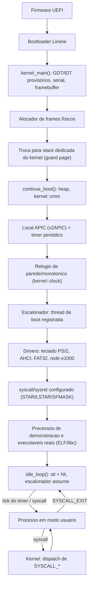
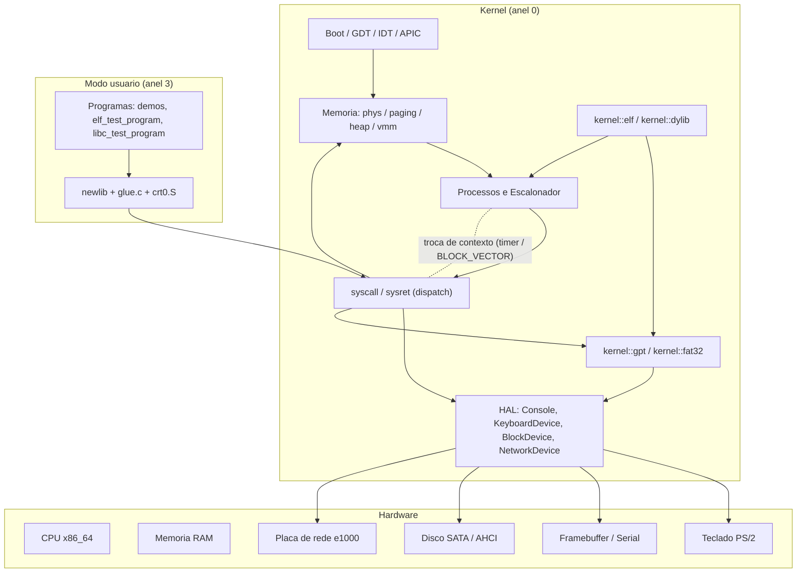
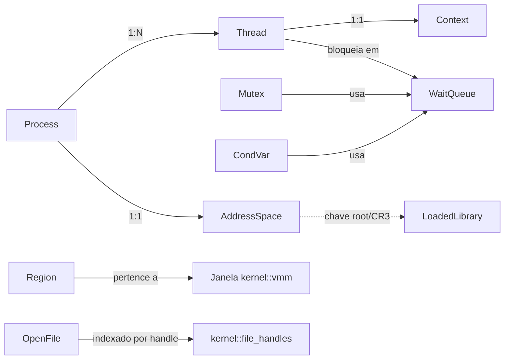
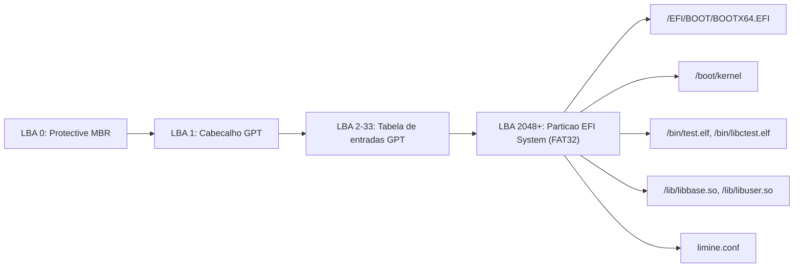
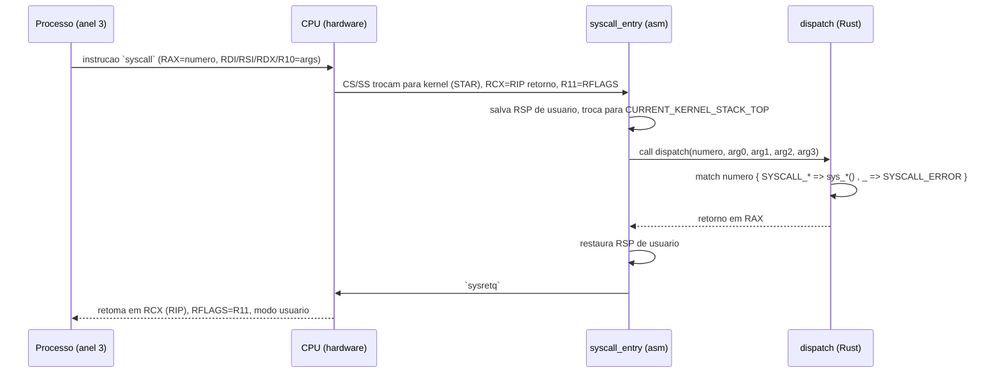
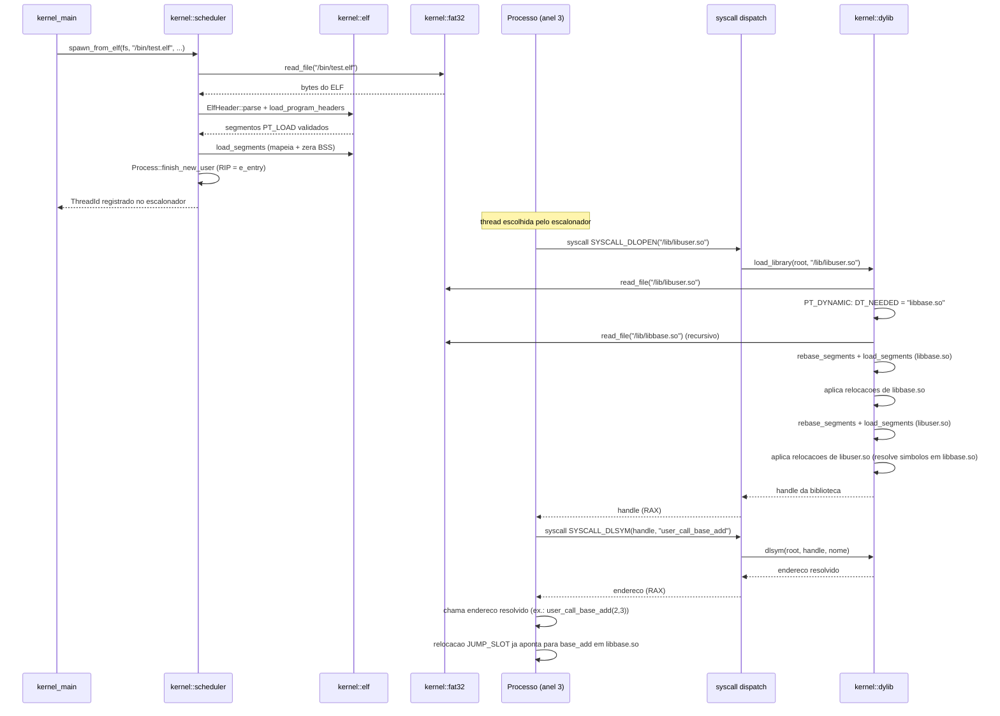

# SPECIFICATION.md

Documento Mestre para Specification-Driven Development (SDD) — **Java OS**

> Gerado pela change OpenSpec `generate-system-specification`. Fonte da verdade
> primária: o código-fonte em `kernel/src/`, `userland_c/`, `elf_test_program/`,
> `elf_test_library_base/`, `elf_test_library_user/` e `xtask/`. Fontes
> secundárias consolidadas: as 22 changes arquivadas em
> `openspec/changes/archive/`, mais a change `libc-minimal-port` (concluída,
> ainda não arquivada), as 25 capabilities em `openspec/specs/`,
> `docs/architecture/overview.md`, `README.md` e `KNOW_ISSUES.md`. Onde uma
> seção do template de origem (`Specification-Driven Development.pdf`) não tem
> equivalente no domínio de um kernel bare-metal, isso é declarado
> explicitamente como "Não aplicável", com justificativa — nunca deixado em
> branco nem preenchido com suposição.

## 1. VISÃO GERAL DO SISTEMA

### 1.1 Objetivo

O Java OS é um sistema operacional de 64 bits (x86_64) construído do zero em
Rust, cujo objetivo de longo prazo é executar aplicações Java como plataforma
principal — não "Linux com uma JVM em cima", mas um kernel próprio, não-POSIX,
desenhado desde o início para hospedar uma JVM (idealmente o HotSpot/OpenJDK)
como seu principal runtime de aplicação, com uma "Java OS Platform" (serviços
de sistema em Java) e uma "Gaming Platform" (launcher e emuladores em Java)
planejadas por cima dele (ver `docs/architecture/overview.md`, seções 9–11,
e `README.md`).

**Problema de negócio.** Hoje, para rodar uma aplicação Java "como plataforma
principal" de um dispositivo (em vez de como um processo entre muitos sobre
Linux/Windows/macOS), não existe um sistema operacional minimalista desenhado
especificamente em torno da JVM — os SOs existentes carregam décadas de
superfície POSIX/Win32 que uma plataforma dedicada a aplicações Java não
precisa. O Java OS resolve isso construindo, de baixo para cima, apenas o
conjunto mínimo de primitivas de kernel que uma JVM madura (HotSpot) realmente
exige — memória virtual, threads nativas com bloqueio real, sinal de
safepoint, relógio, E/S de arquivo, carregamento dinâmico de bibliotecas — sem
herdar nem reimplementar um ambiente POSIX genérico.

**Público-alvo.** O projeto está, nesta fase, em estágio de desenvolvimento de
kernel puro — não há usuário final ainda. O "público" atual é a própria equipe
de desenvolvimento (e qualquer agente de IA operando sobre `CLAUDE.md`/este
documento), que consome o kernel via `cargo xtask run`/`cargo xtask test` em
QEMU. O público-alvo de longo prazo (pós-porte da JVM) são desenvolvedores de
aplicações Java rodando sobre a "Java OS Platform" e usuários finais de
dispositivos que rodem o Java OS como firmware/SO principal (ver roadmap,
seção 20).

**Benefícios:**
- Superfície de kernel mínima e auditável: cada primitiva (memória virtual,
  threads, syscalls, sistema de arquivos, linker dinâmico) foi implementada e
  verificada em boot real uma de cada vez, com o motivo de cada decisão
  registrado (ver seção 3 — Regras de Negócio, e as 22 changes arquivadas em
  `openspec/changes/archive/`).
- Caminho de porte de JVM desenhado deliberadamente para não depender de
  nenhuma API exclusiva de Linux (ex.: rejeita `dlopen("/proc/self/fd/...")`
  do build estático do OpenJDK/Leyden precisamente por depender de `/proc`,
  que o Java OS não tem nem pretende ter — ver seção 6/19).
- Todo comportamento de baixo nível (paginação, GDT/IDT, `syscall`/`sysret`,
  drivers PCI/AHCI/e1000) é escrito à mão no próprio projeto, sem depender de
  crates de terceiros para o núcleo do kernel — reduz superfície de confiança
  externa e mantém controle fino sobre decisões que afetam o porte futuro da
  JVM (ex.: layout de memória, sinalização de safepoint).

### 1.2 Escopo

**Incluído (implementado e verificado em boot real, nesta data):**
- Boot UEFI via Limine, kernel Rust `no_std` monolítico modular (seção 2).
- Gerência de memória física/virtual própria: alocador de frames, paginação
  de 4 níveis, heap do kernel, memória virtual anônima POSIX (`mmap`-like).
- Processos e threads com escalonador preemptivo round-robin; modo usuário
  (anel 3) com interface `syscall`/`sysret`; 22 chamadas de sistema (`SYSCALL_WRITE`
  até `SYSCALL_EXIT`, números 0–21).
- HAL com quatro traits (`Console`, `KeyboardDevice`, `BlockDevice`,
  `NetworkDevice`) e drivers: console serial, console de framebuffer, teclado
  PS/2, armazenamento AHCI, rede Ethernet e1000.
- Sistema de arquivos FAT32 somente leitura (localizado via GPT), exposto a
  modo usuário via `SYSCALL_OPEN`/`READ`/`CLOSE`.
- Carregador de executáveis ELF64 estáticos (`ET_EXEC`) e linker dinâmico
  mínimo de bibliotecas compartilhadas ELF64 (`ET_DYN`, `dlopen`/`dlsym`).
- Primitivas POSIX mínimas para hospedar uma JVM: `pthread_mutex`/
  `pthread_cond` nomeados, relógio de parede/monotônico, sinal de safepoint
  (retry automático via falta de página), tudo exposto a modo usuário.
- Port mínimo de uma libc C (newlib retargetado) sem suporte a ponto
  flutuante, verificado com um programa C real executando `malloc`/E/S de
  arquivo/`exit()` sobre o carregador ELF.

**Não incluído (fora de escopo desta geração do documento — roadmap futuro,
seção 20, nenhuma linha de código ainda):**
- Qualquer parte de uma JVM/HotSpot em si (o próximo passo concreto do
  roadmap, ainda não iniciado).
- Suporte a ponto flutuante em modo usuário (bloqueado pela ausência de
  salvamento de estado FPU/SSE na troca de contexto — ver seção 19).
- SMP (múltiplos núcleos), isolamento de falhas por processo, qualquer GUI,
  rede com pilha de protocolos (TCP/IP), qualquer uma das "Java OS Platform"/
  "Gaming Platform" em Java.
- Suporte a hardware real fora de QEMU/VirtualBox/VMware (várias
  simplificações — endereço fixo de I/O APIC, mecanismo legado de PCI, sem
  parsing de ACPI/MADT — assumem essas VMs; ver seção 19).

### 1.3 Fluxo Geral

O fluxo operacional do sistema, da energização até o estado estável de boot,
segue a sequência abaixo (fiel a `kernel_main`/`continue_boot` em
`kernel/src/main.rs`):



Qualquer falha irrecuperável durante o boot (recursos de hardware ausentes,
falha de alocação, exceção de CPU não tratável) interrompe esse fluxo e entra
em `hlt_loop()` — interrupções desabilitadas, `hlt` em loop — reportando a
causa pelo console serial/framebuffer antes de parar (ver seção 3, BR-001).
Dispositivos opcionais (framebuffer, armazenamento, rede) cuja ausência não
impede o boot são tratados como indisponíveis e o boot prossegue sem eles
(ver seção 3, BR-010).

## 2. ARQUITETURA

### 2.1 Visão Arquitetural

**Estilo Arquitetural**: kernel monolítico modular — um único espaço de
endereçamento privilegiado (anel 0) contendo gerência de memória, escalonador,
drivers e syscalls, organizado em módulos Rust internos por subsistema
(`kernel::paging`, `kernel::scheduler`, `kernel::fat32`, etc. — ver
`kernel/src/lib.rs` para a lista completa de 42 módulos públicos). Não é
microkernel (decisão original de `kernel-boot-foundation`, nunca revisitada):
reduz a complexidade de IPC entre serviços do kernel nesta fase, às custas de
isolamento de falhas entre subsistemas (ver seção 19).

Não é uma arquitetura de aplicação web (sem camadas Frontend/API/
Service/Repository/Database) — "Incluído/Não Incluído" da seção 1.2 já reflete
o domínio real.

**Tecnologias:**

| Camada | Tecnologia | Versão |
|---|---|---|
| Linguagem do kernel | Rust `no_std`, nightly | pinada em `rust-toolchain.toml` |
| Boot | UEFI + bootloader Limine | branch `v11.x-binary`, commit `5be26a73d7b7b4d4477d18be94e1d16e615adf56` |
| Crate de boot protocol | `limine` (crates.io) | 0.6.5 |
| Heap allocator | `linked_list_allocator` | (ver `kernel/Cargo.toml`) |
| Automação de build | `cargo-xtask` (crate própria `xtask/`) | — |
| Emulação/teste | QEMU + OVMF (UEFI firmware) | — |
| libc C (userland) | newlib retargetado, sem ponto flutuante | `newlib-4.6.0.20260123`, vendorizada em `vendor/` |
| Cross-compilador C | wrapper fino sobre o GCC do host (`x86_64-elf-gcc`) | GCC 15.2.0 do host, no momento da implementação |

Não há "Banco" nem "Cache" nem "Mensageria" nesta tabela — ver seção 6/10 para
os equivalentes reais (armazenamento FAT32/AHCI; sem cache nem fila de
mensagens).

### 2.2 Diagrama Arquitetural



### 2.3 Estrutura de Módulos

A tabela abaixo cobre os 42 módulos públicos de `kernel/src/lib.rs` (exceto os
módulos `*_demo`/`user_*demo`/`exit_demo`, que são apenas código de
verificação de boot real, listados à parte ao final).

| Módulo | Responsabilidades | Principais dependências |
|---|---|---|
| `apic` | Local APIC (x2APIC via MSR): detecção, inicialização, EOI, timer interno, ID do core | `port` (MSRs) |
| `clock` | Relógio de parede (RTC) e monotônico (TSC calibrado) | `apic`/`timer` (calibração via PIT) |
| `dylib` | Linker ELF dinâmico mínimo: `PT_DYNAMIC`, `DT_NEEDED`, relocações, `dlopen`/`dlsym` | `elf`, `fat32`, `paging`, `phys` |
| `elf` | Parsing ELF64 (`ET_EXEC`/`ET_DYN`), mapeamento de segmentos `PT_LOAD` | `paging`, `phys`, `hhdm` |
| `fat32`/`gpt` | Montagem FAT32 somente leitura sobre partição localizada via GPT | `hal::BlockDevice` |
| `file_handles` | Tabela de handles de arquivo aberto (cursor de leitura) | `fat32` |
| `fmtbuf` | Buffer de formatação de tamanho fixo em stack (`StackBuf`) | — |
| `framebuffer` | Console de texto sobre framebuffer linear do Limine | `hal::Console` |
| `gdt` | GDT/TSS próprios (seletores kernel/usuário, IST de double/page fault) | — |
| `hal` | Traits `Console`/`KeyboardDevice`/`BlockDevice`/`NetworkDevice` | — |
| `heap` | Heap allocator global (`linked_list_allocator`) crescendo sob demanda | `paging`, `phys` |
| `hhdm` | Conversão físico↔virtual via Higher-Half Direct Map do Limine | — |
| `idt` | IDT própria, handlers de exceção de CPU, handler padrão de IRQ | `gdt` |
| `ioapic` | Roteamento de IRQ externa (endereço MMIO fixo) para o Local APIC | `paging` |
| `keyboard` | Driver PS/2 (controlador 8042), tradução de scancodes | `hal::KeyboardDevice`, `ioapic` |
| `memmap_report` | Formatação pura do mapa de memória do Limine | — |
| `network` | Driver Ethernet Intel e1000 (`hal::NetworkDevice`) | `pci` |
| `paging` | Paginação de 4 níveis: `Mapper`, `AddressSpace`, `PageFlags` | `phys`, `hhdm` |
| `pci` | Acesso a configuração PCI (portas 0xCF8/0xCFC), leitura e escrita | `port` |
| `phys` | Alocador de frames físicos (lista livre intrusiva) | `hhdm` |
| `pic` | Desabilitação do PIC 8259 legado | `port` |
| `port` | Primitivas `inb`/`outb`/`inl`/`outl` de I/O de porta | — |
| `process` | `Process`/`Thread`/`Context`, criação de threads kernel/usuário | `paging`, `stack`, `gdt` |
| `pthread` | `Mutex`/`CondVar` nomeados (bloqueio real) | `wait_queue` |
| `pthread_handles` | Tabela de handles para `Mutex`/`CondVar` dinâmicos | `pthread` |
| `safepoint` | Registro de faixas de "poll de safepoint" (retry automático de `#PF`) | `vmm`, `idt` |
| `scheduler` | Escalonador preemptivo round-robin, troca de contexto em assembly | `process`, `wait_queue`, `gdt`, `idt` |
| `serial` | Console serial (UART 16550), espelhamento para framebuffer | `hal::Console`, `framebuffer` |
| `stack` | Stack dedicada do kernel com guard page; pool de stacks por thread | `paging`, `phys` |
| `storage` | Driver AHCI (`hal::BlockDevice`) | `pci` |
| `sync` | `Spinlock` (exclusão mútua por busy-wait) | — |
| `syscall` | Interface `syscall`/`sysret`, ABI, tabela de despacho (22 chamadas) | quase todos os módulos acima |
| `timer` | Timer periódico do Local APIC, calibração via PIT 8254 | `apic`, `port` |
| `vmm` | Memória virtual anônima: `reserve`/`commit`/`decommit`/`protect`/`release` | `paging`, `phys` |
| `wait_queue` | Bloqueio/despertar voluntário de thread sem busy-wait | `scheduler` |

**Módulos de demonstração/verificação** (código de prova em boot real, não
infraestrutura reutilizável): `clock_demo`, `exit_demo`, `fat32_demo`,
`file_syscalls_demo`, `keyboard_demo`, `network_demo`, `pthread_demo`,
`safepoint_demo`, `storage_demo`, `user_demo`, `user_posix_demo`, `vmm_demo`,
`wait_demo`.

**Dependências entre crates do workspace** (`Cargo.toml` raiz): `kernel`
(crate principal), `xtask` (build/run/test), `elf_test_program`/
`elf_test_library_base`/`elf_test_library_user` (binários de teste de modo
usuário, compilados para os targets `x86_64-java_os_user.json`/
`x86_64-java_os_user_pic.json`), e os artefatos C em `userland_c/` (não um
crate Cargo — compilados via o wrapper `scripts/cross/x86_64-elf-gcc` e
`libc.a` do newlib vendorizado).

## 3. REGRAS DE NEGÓCIO

> Adaptação de domínio: "regra de negócio" aqui significa uma invariante ou
> política do kernel com força de contrato — um comportamento que, se violado,
> quebra a correção ou a segurança do sistema, não uma regra de processo de
> negócio tradicional (não há "cliente"/"pedido" neste domínio).

### BR-001 — Comportamento Definido de Halt em Erro Irrecuperável

**Descrição**: qualquer erro irrecuperável durante o boot ou a execução
(recurso de hardware obrigatório ausente, falha de alocação, exceção de CPU
não tratável) reporta a causa pelo console serial/framebuffer e então entra
em `hlt_loop()` (interrupções desabilitadas, `hlt` em loop) — nunca um reset,
nunca uma continuação em estado indefinido.

**Motivação**: um kernel que continua executando após um erro que invalida
suas próprias invariantes (ex.: alocador de frames não inicializado) arrisca
corromper memória silenciosamente; interrupções são desabilitadas porque
processá-las nesse estado seria igualmente arriscado.

**Implementação**: `kernel::hlt_loop` (`kernel/src/lib.rs:60`), chamada por
`panic_handler`, `alloc_error_handler` (`kernel/src/main.rs`), e por todo
handler de exceção fatal (`kernel::idt::{page_fault_handler, double_fault_handler,
general_protection_fault_handler}`).

**Entradas**: uma condição de erro (enum de erro específico do subsistema, ou
`PanicInfo`). **Processamento**: formata a mensagem de diagnóstico em um
`StackBuf` de tamanho fixo (sem alocação dinâmica, segura mesmo se o heap
estiver corrompido) e escreve via `serial_println_emergency!` (ignora locks —
seguro mesmo com um lock de impressão já retido). **Saída**: `cli; loop { hlt
}`, nunca retorna.

**Exemplo**: falha ao inicializar o alocador de frames físicos —
`kernel_main` reporta `"ERRO FATAL: falha ao inicializar o alocador de frames
fisicos: {:?}"` e chama `hlt_loop()` (`kernel/src/main.rs:139-146`).

**Impacto**: contrato testado pelo smoke test de boot (`cargo xtask test`) e
por toda verificação manual de exceção de CPU desde `kernel-boot-foundation`.

### BR-002 — Halt Ocioso de Sucesso Distinto de Halt de Erro

**Descrição**: ao final de uma sequência de boot bem-sucedida, o kernel entra
em `idle_loop()` (interrupções **habilitadas**, `hlt` em loop) — distinto de
`hlt_loop()` (BR-001). A partir daqui, a CPU só acorda para tratar
interrupções (timer, IRQs) e volta a dormir.

**Motivação**: separar semanticamente "parei porque terminei com sucesso e
dependo de interrupções futuras" de "parei porque algo quebrou e não confio
mais no estado do sistema".

**Implementação**: `kernel::idle_loop` (`kernel/src/lib.rs:74`), chamada ao
final de `continue_boot` (`kernel/src/main.rs:407`).

**Exemplo/Impacto**: o escalonador assume a partir daqui — toda troca de
contexto subsequente acontece a partir de uma interrupção do timer ou de
`syscall`, nunca por retorno de `idle_loop`.

### BR-003 — Layout Fixo de Índices de PML4 por Região Compartilhada

**Descrição**: cada região de memória compartilhada entre todos os processos
(HHDM, heap do kernel, stack de boot, pool de stacks de thread, janela de
`kernel::vmm`) ocupa um índice fixo e documentado da PML4, nunca sobreposto:
HHDM (índice 256), heap (288, `0xffff_9000_0000_0000`), stack de boot (320,
`0xffff_a000_0000_0000`), pool de stacks de thread (352,
`0xffff_b000_0000_0000`), janela do `kernel::vmm` (384,
`0xffff_c000_0000_0000`).

**Motivação**: uma colisão de índice entre duas regiões compartilhadas
corrompe silenciosamente memória de uma thread/subsistema arbitrário — já
ocorreu uma vez de verdade (ver seção 19, dívida técnica/histórico de bugs):
`kernel::vmm::VMM_WINDOW_START` originalmente reusava o índice 352 (já do pool
de stacks de thread), corrigido na change `kernel-safepoint-signal` movendo
para o índice 384.

**Implementação**: constantes documentadas em `kernel::stack::THREAD_STACK_POOL_BASE`,
`kernel::vmm::VMM_WINDOW_START` (`kernel/src/vmm.rs:40`), `kernel::heap`,
e consolidadas em `docs/architecture/overview.md`, seção 1.

**Impacto**: qualquer região nova compartilhada entre processos (futura)
precisa reservar um índice de PML4 inédito e registrá-lo em
`docs/architecture/overview.md` — esta regra é, na prática, o checklist que
evita a repetição do bug.

### BR-004 — Metade Superior da PML4 Compartilhada por Referência entre Processos

**Descrição**: toda `AddressSpace` nova copia, por referência (mesmo endereço
físico de tabela intermediária), as entradas de índice 256–511 da PML4 ativa
no momento de sua criação — garantindo que o kernel (HHDM, heap, stacks,
`vmm`) permaneça acessível após qualquer troca de `CR3`. A metade inferior
(0–255) começa vazia, exclusiva de cada processo.

**Motivação**: sem isso, cada processo precisaria de seu próprio mapeamento
completo do kernel, desperdiçando memória e arriscando divergência.

**Implementação**: `AddressSpace::new` (`kernel/src/paging.rs:371`),
`KERNEL_PML4_START = 256`.

**Exceção documentada (achado real, `kernel-syscalls`)**: uma tabela
intermediária compartilhada só é visível a uma `AddressSpace` se já existia na
PML4 ativa *no momento em que essa `AddressSpace` foi criada* — populá-la
depois não se propaga retroativamente. Corrigido para o pool de stacks de
thread via `kernel::stack::prime_thread_stack_pool`, chamada obrigatoriamente
antes de qualquer `AddressSpace::new()` (`kernel/src/main.rs:317`).

### BR-005 — Toda Página Comprometida por `kernel::vmm` Vem Zerada

**Descrição**: `Vmm::commit` sempre zera o conteúdo do frame físico (via o
alias HHDM) **antes** de mapeá-lo — nunca expõe memória física reaproveitada
com conteúdo residual de um uso anterior.

**Motivação**: memória não zerada exporia dados de outro processo/alocação
anterior — um vazamento de informação clássico, inaceitável mesmo num kernel
de pesquisa.

**Implementação**: `kernel::vmm::Vmm::commit` (`kernel/src/vmm.rs`, ordem
"zera primeiro, mapeia depois" — ver design.md de `kernel-posix-virtual-memory`).
Mesma disciplina em `kernel::elf::load_segment` para a região de BSS de um
executável carregado (achado: `Mapper::map_new` por si só **não** zera o
frame que aloca).

**Impacto**: testado em boot real (`kernel::vmm_demo`, `/bin/test.elf` —
"BSS: zerado corretamente pelo carregador - PASSOU").

### BR-006 — Sistema de Arquivos FAT32 é Somente Leitura e Só Nomes Curtos 8.3

**Descrição**: `kernel::fat32::Fat32Filesystem` nunca escreve no disco (sem
criar, truncar ou apagar arquivos/diretórios) e resolve caminhos
exclusivamente por nome curto 8.3 — uma entrada de diretório de nome longo
VFAT (atributo `0x0F`) é ignorada durante a varredura, nunca interpretada como
arquivo/diretório.

**Motivação**: suficiente para a necessidade real motivadora (ler classes do
*class path* de uma JVM futura) e para os arquivos já presentes na imagem de
boot (`KERNEL`, `BOOTX64.EFI`, nomes 8.3 nativos), evitando a complexidade de
escrita segura num FAT real e do algoritmo de reconstrução de nomes longos.

**Implementação**: `kernel::fat32::DirEntry::parse` (variante
`DirEntryKind::LongNamePart`, descartada); `kernel::storage`/`hal::BlockDevice`
não expõem `write_block` a `Fat32Filesystem` em nenhum caminho de leitura.

**Impacto direto em outra regra**: bibliotecas carregadas via `dlopen` (ver
BR-013) precisam de nomes de arquivo curtos *desde a origem* (`[lib] name =
"base"` no `Cargo.toml`, produzindo `libbase.so`, não
`libelf_test_library_base.so`) — um arquivo renomeado só na imagem não bateria
mais com a string gravada em `DT_NEEDED` pelo linker.

### BR-007 — `--hash-style=sysv` Obrigatório para Bibliotecas Carregadas Dinamicamente

**Descrição**: toda biblioteca compartilhada (`.so`) carregável via `dlopen`
deve ser linkada com `--hash-style=sysv` (ou `both`) — uma biblioteca só com
`--hash-style=gnu` (sem `DT_HASH` clássico) é rejeitada
(`DylibError::MissingSysvHash`).

**Motivação**: `kernel::dylib` lê só os dois primeiros `u32` de `DT_HASH`
(`nbucket`, `nchain`) para descobrir a contagem de símbolos de `.dynsym` — não
implementa a tabela de hash em si (toda resolução de símbolo é varredura
linear). Sem `DT_HASH`, não há como saber esse tamanho sem arriscar um valor
inventado.

**Implementação**: `kernel::dylib` (change `kernel-dynamic-linker`,
"Contagem de símbolos via `DT_HASH`"); aplicado via `RUSTFLAGS` no build das
bibliotecas de teste (`elf_test_library_base`/`user`).

### BR-008 — Isolamento de Guard Page Abaixo de Toda Stack de Kernel

**Descrição**: toda stack de kernel (a stack dedicada de boot e cada stack do
pool por thread) tem a página imediatamente abaixo de seu limite inferior
deliberadamente não mapeada. Um estouro de stack causa uma falta de página
(`#PF`) imediata e diagnosticável, nunca corrupção silenciosa de memória
adjacente.

**Motivação**: descoberta como falha real (`KNOW_ISSUES.md`): sem guard page,
um estouro de stack sobrescrevia memória adjacente silenciosamente antes de
eventualmente causar uma falha não diagnosticável.

**Implementação**: `kernel::stack::map`/`alloc_thread_stack`
(`kernel/src/stack.rs`); o handler de `#PF` (`kernel::idt::page_fault_handler`)
usa uma stack própria via IST (`PAGE_FAULT_IST_INDEX = 2`) — sem isso, a
própria entrega do `#PF` falharia ao tentar empilhar seu frame numa stack já
invadida, escalando para `#DF` (achado real de `kernel-stack-guard-page`).

### BR-009 — Stack de Kernel Confiável (`TSS.rsp0`) Sempre Coerente com a Thread Corrente

**Descrição**: `TSS.rsp0` (consultado automaticamente pela CPU em qualquer
transição de anel 3→anel 0 com troca de privilégio) e
`CURRENT_KERNEL_STACK_TOP` (consultado manualmente pela rotina de entrada de
`syscall`, que não usa `TSS.rsp0` automaticamente) são atualizados juntos, no
único ponto `set_current_kernel_stack`, a cada troca de contexto — nunca
separadamente.

**Motivação**: divergência entre os dois faria uma interrupção ou `syscall`
futura usar a stack de kernel de outra thread — corrupção silenciosa de
stack, pior que o bug de guard page original (BR-008).

**Implementação**: `kernel::scheduler::set_current_kernel_stack`
(`kernel/src/scheduler.rs:108`), chamada por `register_boot_thread` e por
`schedule_next` a cada troca.

### BR-010 — Indisponibilidade de Dispositivo Opcional Não Impede o Boot

**Descrição**: framebuffer, controlador AHCI e placa de rede são tratados como
opcionais — sua ausência (nenhuma resposta do bootloader, nenhum controlador
encontrado na enumeração PCI) é reportada pelo console serial e o boot
prossegue sem o recurso, nunca um halt.

**Motivação**: o console serial sozinho já é suficiente para diagnóstico
automatizado (smoke test); exigir cada periférico opcional tornaria o kernel
frágil a variações de configuração de VM.

**Implementação**: `kernel_main`/`continue_boot`
(`kernel/src/main.rs:68-84, 267-303`) — cada inicialização opcional usa
`match`/tratamento de `Err` explícito, nunca `.expect()`.

**Contraste**: inicializações consideradas obrigatórias (revisão base do
Limine, HHDM, alocador de frames, heap, suporte a x2APIC) usam `hlt_loop()`
em caso de falha (BR-001) — a distinção entre "obrigatório" e "opcional" é
deliberada por recurso, documentada inline em cada ponto de inicialização.

### BR-011 — `syscall`/`sysret`: Layout de GDT na Ordem Exigida pela Aritmética de `STAR`

**Descrição**: o GDT do kernel ordena as entradas como null, código de kernel
(0x08), dados de kernel (0x10), **dados de usuário (0x18)**, **código de
usuário (0x20)** — dados de usuário antes de código de usuário, ao contrário
da ordem código-antes-de-dados usada para o kernel. Essa ordem não é
arbitrária: decorre diretamente da fórmula fixa do hardware para `sysret` em
64 bits (`CS = (U+16)|3`, `SS = (U+8)|3`).

**Motivação**: é a convenção universal de qualquer kernel x86_64 com
`syscall`/`sysret` (não uma escolha de estilo) — uma ordem diferente quebraria
`sysret` silenciosamente (CS/SS apontando para seletores errados).

**Implementação**: `kernel::gdt::Gdt` (`kernel/src/gdt.rs:161-194`),
`SYSRET_SELECTOR_BASE = 0x10` em `kernel::syscall::init`.

**Verificação**: testes de host `sysret_selector_base_lands_on_the_user_segments`/
`syscall_cs_base_lands_on_kernel_segments` (`kernel/src/syscall.rs:557-571`).

### BR-012 — Toda Operação de VM Anônima Opera sobre Reservas Vivas com Handle Geracional

**Descrição**: uma reserva de `kernel::vmm` é identificada por um handle
opaco com geração (`Region { base, size, generation }`); qualquer operação
(`commit`/`decommit`/`protect`/`release`) sobre um handle cuja geração não
bate mais com a reserva atualmente viva naquele endereço é rejeitada
(`VmmError::StaleHandle`) — nunca opera silenciosamente sobre uma reserva
diferente que por acaso reaproveitou o mesmo endereço virtual (problema ABA).

**Motivação**: endereços virtuais liberados são reaproveitados por reservas
futuras (`RangeAllocator::release`, com coalescência de faixas livres
adjacentes); sem geração, um handle "velho" apresentado depois de o endereço
ser reaproveitado operaria sobre a reserva nova por engano.

**Implementação**: `kernel::vmm::Region`, `ReservationTable`
(`kernel/src/vmm.rs`).

### BR-013 — Carregamento Dinâmico Resolve Dependências Recursivamente, Rejeita Ciclos

**Descrição**: `kernel::dylib::load_library` resolve cada `DT_NEEDED` da
biblioteca em `/lib/<nome>` e a carrega recursivamente **antes** de aplicar as
relocações da biblioteca dependente. Uma dependência circular real (A→B→A) é
detectada (via uma pilha transitória de caminhos "em carregamento") e
rejeitada (`DylibError::CircularDependency`) — nunca uma recursão infinita.

**Motivação**: sem a ordem "dependências primeiro", os símbolos da dependência
não estariam disponíveis quando a resolução da dependente rodasse; sem
detecção de ciclo, um ciclo real travaria o kernel por estouro de stack.

**Implementação**: `kernel::dylib::load_library` (change
`kernel-dynamic-linker`, "`DT_NEEDED` resolvido... com detecção de ciclo").

### BR-014 — Toda Syscall Rejeita Entrada Inválida com um Sentinela, Nunca Executa Serviço Arbitrário

**Descrição**: um número de chamada desconhecido, ou qualquer falha
alcançável por uma syscall válida (handle desconhecido, endereço fora de
reserva, UTF-8 inválido em um ponteiro de string), devolve o sentinela
`SYSCALL_ERROR = u64::MAX` em `RAX` — nunca interpreta a entrada como se fosse
válida.

**Motivação**: é a única rede de segurança entre modo usuário (não confiável)
e o despacho de syscalls; sem ela, um número/argumento malformado poderia
acionar um caminho de código não intencional.

**Implementação**: `kernel::syscall::dispatch` (`kernel/src/syscall.rs:455-481`,
`match` com braço `_ => SYSCALL_ERROR`); cada `sys_*` individual segue o mesmo
padrão para suas próprias falhas (ex.: `sys_vm_commit` sobre endereço fora de
qualquer reserva).

**Limitação documentada**: todo erro colapsa no mesmo sentinela — não há
esquema granular estilo `errno` (ver seção 19).

### BR-015 — Ponteiros de Modo Usuário Passados a Syscalls Não São Validados

**Descrição**: `ptr`/`len` recebidos por `SYSCALL_WRITE`, `SYSCALL_DLOPEN`,
`SYSCALL_OPEN`, `SYSCALL_READ`, etc. são usados diretamente
(`core::slice::from_raw_parts`) sem verificar se o endereço é válido ou
realmente pertence ao chamador.

**Motivação**: Non-Goal explícito desde `kernel-process-scheduler`/
`kernel-syscalls` — isolamento de falhas por processo é trabalho futuro; um
ponteiro inválido causa um `#PF` fatal que ainda derruba o kernel inteiro
(ver BR-001), não um erro recuperável da syscall.

**Implementação**: `kernel::syscall::sys_write`/`sys_dlopen`/`sys_open`
(comentários `# Safety` explícitos em cada função `unsafe fn sys_*`).

**Impacto**: registrado explicitamente como dívida técnica (seção 19) — é o
principal risco de segurança do sistema tal como está hoje.

### BR-016 — Recursos Terminados Não São Liberados (Leak Deliberado)

**Descrição**: ao final de um processo (`SYSCALL_EXIT`), de uma biblioteca
carregada, ou de um mutex/condvar/handle de arquivo cujo objeto exige
referência `'static`, os recursos associados (stack de kernel, entradas em
`CONTEXTS`/`TERMINATED`, bibliotecas em `DYLIB_STATE`, objetos `Box::leak`ados
em `pthread_handles`) não são liberados — exceto o conteúdo de um arquivo
fechado via `SYSCALL_CLOSE` (ver BR-017, exceção deliberada).

**Motivação**: nenhuma change implementou ainda encerramento de
processo/thread; liberar recursos parcialmente seria mais arriscado (frames
vazados de forma inconsistente) do que vazar tudo de forma consistente e
documentada.

**Implementação**: comentários explícitos em `kernel::scheduler`
(`TERMINATED`/`CONTEXTS: "Sem remoção"`), `kernel::pthread_handles`
(`Box::leak`), `kernel::dylib::DYLIB_STATE` (nunca remove uma entrada por
`root`).

### BR-017 — Exceção à Regra de Leak: Conteúdo de Arquivo é Liberado ao Fechar

**Descrição**: ao contrário de `pthread_handles` (BR-016), `kernel::file_handles::close`
libera imediatamente o `Vec<u8>` do conteúdo de um arquivo fechado.

**Motivação**: carregamento de classes pode abrir centenas de arquivos
`.class` ao longo da vida de uma JVM futura — nunca liberar o conteúdo lido
exauriria o heap do kernel de forma previsível e rápida; mutexes/condvars, por
comparação, são tipicamente criados uma vez e mantidos pela vida do processo.

**Implementação**: `kernel::file_handles::close` (`kernel/src/file_handles.rs:61-70`,
substitui a entrada por `None`, liberando o `Vec<u8>`).

### BR-018 — Tabelas de Handle Nunca Reaproveitam Índice (Sem Esquema de Geração)

**Descrição**: `kernel::file_handles`/`kernel::pthread_handles` sempre fazem
`push` de uma nova entrada ao criar/abrir — nunca reaproveitam o primeiro slot
`None`/livre, mesmo depois de um `close`.

**Motivação**: reaproveitar um índice criaria o mesmo problema ABA que `Region`
evita com geração (BR-012) — um handle antigo (fechado) voltaria a apontar
silenciosamente para um recurso completamente diferente assim que o índice
fosse reaproveitado. O custo (um `Option::None` residual por handle
historicamente aberto) é aceito como desprezível frente ao risco.

**Implementação**: `kernel::file_handles::register`/`kernel::pthread_handles::create_mutex`/
`create_cond` (sempre `table.push(...)`, nunca busca por slot livre).

### BR-019 — Conversão de Ciclos de TSC para Nanossegundos Evita Overflow Dividindo Antes de Multiplicar

**Descrição**: `monotonic_nanos()` calcula `segundos = ciclos / freq_hz; resto
= ciclos % freq_hz; nanos = segundos * 1e9 + resto * 1e9 / freq_hz` — nunca
`ciclos * 1e9 / freq_hz` diretamente.

**Motivação**: a ordem ingênua estoura `u64` depois de poucos segundos de
tempo de atividade (a ~3 bilhões de ciclos/s, `ciclos * 1e9` já se aproxima do
limite de `u64` com menos de 10s de uptime).

**Implementação**: `kernel::clock::cycles_to_nanos` (função pura, testável em
host).

### BR-020 — Ano do RTC Assumido na Década 2000–2099, Sem Registrador de Século

**Descrição**: `kernel::clock::wall_clock_nanos` lê o ano de 2 dígitos do RTC
CMOS e assume `2000 + ano`, sem localizar/parsear nenhum registrador de
século (posição não padronizada entre BIOS/UEFI).

**Motivação**: cobre toda a vida útil esperada deste kernel sem a
complexidade de localizar/parsear ACPI — mesmo espírito de simplificação já
aplicado a `kernel::ioapic`/`kernel::pci` (endereços/mecanismos fixos em vez
de descoberta via ACPI).

**Implementação**: `kernel::clock::init` (leitura do RTC, change
`kernel-wall-clock`).

**Impacto**: documentado explicitamente como limitação a revisar apenas se o
kernel precisar rodar além de 2099 (seção 19).

## 4. CASOS DE USO

> Adaptação de domínio: "caso de uso" aqui é um fluxo operacional técnico do
> kernel (não há usuário final de aplicação ainda) — "ator" é tipicamente o
> próprio kernel, o bootloader, ou um processo de modo usuário.

### UC-001 — Boot Completo até Estado Ocioso

**Objetivo**: levar o sistema de energização a um estado estável, pronto para
escalonar processos. **Atores**: firmware UEFI, bootloader Limine, kernel.
**Pré-condições**: hardware compatível com x2APIC, UEFI, x86_64.
**Pós-condições**: escalonador ativo, todos os drivers disponíveis
inicializados, processos de demonstração/reais em execução.

**Fluxo principal**: 1) UEFI carrega o Limine; 2) Limine carrega o kernel e
popula as *boot requests* (`BaseRevision`, `BootloaderInfoRequest`,
`MemmapRequest`, `HhdmRequest`, `FramebufferRequest`); 3) `kernel_main`
monta GDT/IDT provisórios e o console serial; 4) inicializa (se disponível) o
console de framebuffer; 5) valida a revisão base do protocolo Limine e a
resposta de HHDM (obrigatórios — BR-001 se ausentes); 6) reporta o banner de
boot e o mapa de memória; 7) inicializa o alocador de frames físicos; 8)
mapeia e troca para a stack dedicada do kernel (guard page); 9) `continue_boot`
inicializa heap, `kernel::vmm`, Local APIC/timer, relógio, registra a thread
de boot no escalonador; 10) inicializa teclado, armazenamento (+FAT32), rede
(cada um opcional — BR-010); 11) configura `syscall`/`sysret`; 12) cria
processos de demonstração e executáveis reais (ELF estático, libc C); 13)
entra em `idle_loop()`.

**Fluxos alternativos**: A1. Framebuffer indisponível — prossegue só com
serial (passo 4). A2. Armazenamento/rede indisponível — prossegue sem o
recurso (passo 10).

**Fluxos de exceção**: E1. Revisão Limine não suportada, ou sem resposta de
HHDM, ou CPU sem x2APIC, ou falha de alocação de frames/heap — `hlt_loop()`
(BR-001). E2. Exceção de CPU (`#PF`/`#GP`/`#DF`) antes da IDT própria estar
instalada — resultaria em triple fault (motivo pelo qual a IDT é montada
antes de qualquer outra coisa, passo 3).

### UC-002 — Spawn de Processo em Modo Usuário a partir de Executável ELF

**Objetivo**: carregar e executar um binário ELF64 estático real, lido do
disco. **Atores**: kernel (`kernel::scheduler::spawn_from_elf`). **Pré-condições**:
sistema de arquivos FAT32 montável, arquivo existente e sendo `ET_EXEC`
válido. **Pós-condições**: um novo processo com uma thread em anel 3,
executando a partir do ponto de entrada do ELF.

**Fluxo principal**: 1) lê o arquivo inteiro via `Fat32Filesystem::read_file`;
2) valida cabeçalho ELF64 (`EI_MAG`, `ELFCLASS64`, `ELFDATA2LSB`, `e_type ==
ET_EXEC`, `EM_X86_64`); 3) itera `program headers` do tipo `PT_LOAD`; 4)
cria um novo `AddressSpace` (`Process::begin_new_user`); 5) mapeia cada
segmento `PT_LOAD` (permissões de `p_flags`, zerando páginas antes de copiar
— BR-005); 6) cria a thread inicial com `RIP = e_entry`
(`Process::finish_new_user`); 7) registra o processo/thread no escalonador.

**Fluxos alternativos**: A1. Segmento com `p_memsz > p_filesz` (BSS) — zerado
explicitamente antes da cópia dos bytes do arquivo.

**Fluxos de exceção**: E1. Arquivo não encontrado/ilegível —
`ElfError::FileRead`/`NoDisk`. E2. Cabeçalho inválido ou `e_type != ET_EXEC`
— `ElfError::UnsupportedExecutable`. E3. Dois segmentos `PT_LOAD` cujo
intervalo de página (arredondado) colide — `ElfError::OverlappingSegments`,
sem merge silencioso de permissões. E4. Falha de mapeamento/memória — `Err`
propagado; nenhum processo "fantasma" é registrado no escalonador (o registro
só acontece depois que todos os segmentos mapeiam com sucesso).

### UC-003 — `dlopen`/`dlsym`: Carregamento Dinâmico de Biblioteca em Processo em Execução

**Objetivo**: carregar uma biblioteca compartilhada ELF64 (`ET_DYN`) dentro de
um processo já em execução e resolver um símbolo nela. **Atores**: processo
de modo usuário (via `SYSCALL_DLOPEN`/`SYSCALL_DLSYM`), `kernel::dylib`.
**Pré-condições**: processo já em execução (CR3 ativo = o do chamador);
biblioteca presente em `/lib/<nome>`, linkada com `--hash-style=sysv`
(BR-007). **Pós-condições**: biblioteca (e suas dependências `DT_NEEDED`)
mapeadas e relocadas no espaço de endereçamento do chamador; símbolo
resolvido para um endereço utilizável.

**Fluxo principal**: 1) `SYSCALL_DLOPEN` recebe caminho; 2) monta o sistema de
arquivos e lê o `.so`; 3) `kernel::dylib::load_library` localiza
`PT_DYNAMIC`, resolve `DT_NEEDED` recursivamente (BR-013); 4) mapeia os
segmentos `PT_LOAD` relativos a uma base escolhida pelo kernel
(`rebase_segments`); 5) calcula símbolos exportados pela própria biblioteca
(antes das relocações, para suportar auto-referência — achado real); 6)
aplica relocações (`R_X86_64_RELATIVE`/`GLOB_DAT`/`JUMP_SLOT`/`64`) resolvendo
símbolos contra a própria biblioteca e as já carregadas no mesmo espaço de
endereçamento (chaveado por `kernel::paging::current_root()`); 7) registra a
biblioteca em `DYLIB_STATE`, devolve `handle`; 8) `SYSCALL_DLSYM` busca o
símbolo por nome (varredura linear) e devolve seu endereço final.

**Fluxos de exceção**: E1. UTF-8 inválido no caminho/nome — `SYSCALL_ERROR`.
E2. Dependência circular (A→B→A) — `DylibError::CircularDependency`. E3.
Tipo de relocação não suportado (ex.: TLS) — `DylibError::UnsupportedRelocationType`.
E4. Biblioteca maior que o slab de endereço virtual reservado —
`DylibError::LibraryTooLarge`. E5. Símbolo não resolvido em nenhuma biblioteca
já carregada — `DylibError::UnresolvedSymbol`.

### UC-004 — Abrir, Ler e Fechar um Arquivo a partir de Modo Usuário

**Objetivo**: um processo de modo usuário lê o conteúdo de um arquivo do
sistema de arquivos FAT32. **Atores**: processo de modo usuário (via
`SYSCALL_OPEN`/`READ`/`CLOSE`), `kernel::file_handles`. **Pré-condições**:
sistema de arquivos montável; caminho absoluto correspondendo a um arquivo
(não diretório) existente. **Pós-condições**: conteúdo lido para o buffer do
chamador; ao fechar, memória liberada (BR-017).

**Fluxo principal**: 1) `SYSCALL_OPEN` monta o FS e lê o arquivo inteiro
(`Fat32Filesystem::read_file`); 2) `kernel::file_handles::register` registra
o conteúdo com cursor em 0, devolve `handle`; 3) `SYSCALL_READ` copia até
`buf_len` bytes a partir do cursor, avança o cursor; 4) `SYSCALL_CLOSE` libera
o `Vec<u8>` e invalida o `handle`.

**Fluxos de exceção**: E1. Caminho não existe, é diretório, ou componente
intermediário não é diretório — `SYSCALL_ERROR` (sem distinção granular —
BR-014). E2. `handle` desconhecido em `READ`/`CLOSE` — `SYSCALL_ERROR`. E3.
Leitura além do fim do arquivo — devolve `0` bytes, não um erro.

### UC-005 — Troca de Contexto Disparada por Tick do Timer

**Objetivo**: preemptar a thread corrente e retomar a próxima, de forma
transparente a ambas. **Atores**: Local APIC (timer periódico),
`kernel::scheduler`. **Pré-condições**: escalonador com ao menos uma thread
registrada. **Pós-condições**: a thread interrompida tem seu contexto salvo
na própria stack; a próxima thread (round-robin) retoma exatamente de onde
parou.

**Fluxo principal**: 1) timer dispara interrupção no vetor do timer
(`timer_entry`, assembly); 2) empilha todos os registradores de uso geral; 3)
chama `on_timer_tick(current_rsp)`: incrementa contador de ticks + EOI; 4)
`schedule_next`: remove a thread da frente da `ReadyQueue`, salva seu `rsp`,
decide destino (recoloca no fim; desvia para `WaitQueue` se há intenção de
bloqueio pendente — UC-006; ou não recoloca, se terminou via `SYSCALL_EXIT`);
5) escolhe a próxima thread, atualiza `TSS.rsp0`/`CURRENT_KERNEL_STACK_TOP`
(BR-009) e troca `CR3` (sempre, mesmo sem mudança); 6) devolve o `rsp` salvo
da nova thread; 7) a rotina de entrada restaura `RSP` e desempilha os
registradores; 8) `iretq` retoma a execução exatamente onde a nova thread
havia parado.

**Fluxos de exceção**: E1. Nenhuma thread pronta (todas bloqueadas) — pânico
explícito (limitação conhecida fora do escopo atual, ver seção 19).

### UC-006 — Bloqueio e Despertar Voluntário de Thread

**Objetivo**: uma thread sai da rotação do escalonador sem busy-wait, até ser
explicitamente acordada. **Atores**: thread chamadora, `kernel::wait_queue`,
outra thread ou ISR (despertando). **Pré-condições**: vetor de bloqueio
instalado (`install_block_vector`, antes de qualquer uso).

**Fluxo principal**: 1) thread chama `WaitQueue::block_current()`; 2) registra
a intenção de bloqueio (atomicamente, com interrupções desabilitadas); 3)
dispara `int {BLOCK_VECTOR}` (34, vetor de software dedicado — nunca o do
timer, e nunca 33, que colide com o teclado); 4) reentra em
`schedule_next` (mesma lógica de UC-005), que desvia a thread para a
`WaitQueue` em vez de recolocá-la na `ReadyQueue`; 5) em algum momento futuro,
outra thread/ISR chama `wake_one`/`wake_all`, devolvendo-a à `ReadyQueue`
(`with_interrupts_disabled`, seguro mesmo a partir de uma ISR); 6) quando
escolhida de novo pelo escalonador, retoma exatamente depois do `int` do
passo 3.

**Fluxos de exceção**: E1. (Histórico, corrigido) reaproveitar o vetor do
timer para o `int` de bloqueio travava o Local APIC permanentemente (EOI
espúrio sem interrupção real "em serviço") — corrigido com `BLOCK_VECTOR`
dedicado.

### UC-007 — Falta de Página em Ponto de Safepoint (Retry Automático)

**Objetivo**: parar (e depois liberar) todas as threads sondando uma página de
*poll* de safepoint, sem polling explícito em software e sem derrubar o
kernel. **Atores**: thread(s) sondando a página, thread coordenadora
(`SYSCALL_VM_DECOMMIT`/`COMMIT`), `kernel::safepoint`,
`kernel::idt::page_fault_handler`. **Pré-condições**: faixa registrada via
`kernel::safepoint::register` dentro de uma reserva viva de `kernel::vmm`.

**Fluxo principal**: 1) coordenadora `decommit` a página (arma o safepoint);
2) uma thread sondadora acessa a página, gera `#PF` com `P=0` (ausência); 3)
`page_fault_handler` consulta `kernel::safepoint::is_registered(CR2)`; se
registrado e `P=0`, retorna sem reportar nem haltar — o `iretq` gerado pela
ABI `extern "x86-interrupt"` (frame nunca alterado) reexecuta a mesma
instrução; 4) se a página ainda está ausente, novo `#PF`, novo retry
(efetivamente um busy-wait via hardware); 5) coordenadora `commit` a página de
novo; 6) a próxima tentativa de acesso de qualquer thread sondando tem
sucesso, sem nenhum `#PF`.

**Fluxos de exceção**: E1. Falta de página por violação de permissão (`P=1`,
não ausência) — nunca tratada como safepoint, segue o caminho fatal normal
(BR-001). E2. Endereço fora de qualquer faixa registrada — idem, caminho
fatal normal.

## 5. MODELO DE DOMÍNIO

> Adaptação de domínio: "entidades" aqui são as estruturas centrais do kernel
> (não há modelo relacional de negócio). Cada uma referencia sua definição
> real em `kernel/src/`.

### Entidade: `Process` (`kernel::process::Process`, `kernel/src/process.rs:196`)

**Responsabilidade**: dono de um espaço de endereçamento (`AddressSpace`)
isolado, com pelo menos uma thread.

**Atributos**:

| Campo | Tipo | Obrigatório |
|---|---|---|
| `id` | `ProcessId(u64)` | Sim |
| `address_space` | `AddressSpace` | Sim |
| `threads` | `Vec<ThreadId>` | Sim (ao menos 1) |

**Relacionamentos**: Process 1:N Thread (via `threads: Vec<ThreadId>`,
threads reais vivem em `kernel::scheduler::CONTEXTS`, indexadas por
`ThreadId`, não embutidas no `Process`). Process 1:1 `AddressSpace`.

**Regras associadas**: BR-003, BR-004, BR-016.

### Entidade: `Thread` / `Context` (`kernel::process::{Thread, Context}`)

**Responsabilidade**: unidade de escalonamento dentro de um `Process`, com
stack de kernel própria (guard page) e contexto de registradores salvo.

**Atributos de `Thread`**: `id: ThreadId`, `process: ProcessId`, `context:
Context`.

**Atributos de `Context`**: `rsp: u64` (topo da stack no momento da última
interrupção, ou valor sintético inicial), `kernel_stack_top: u64` (fixo,
nunca mutado), `address_space_root: u64` (endereço físico da PML4 do
processo dono).

**Relacionamentos**: Thread N:1 Process. Context 1:1 Thread (vive em
`kernel::scheduler::CONTEXTS: Vec<Context>`, indexado por `ThreadId.0`).

**Regras associadas**: BR-008 (guard page), BR-009 (`TSS.rsp0` coerente).

**Limitação conhecida**: `Context` não cobre registradores FPU/SSE/XMM (ver
seção 19).

### Entidade: `AddressSpace` (`kernel::paging::AddressSpace`, `kernel/src/paging.rs:363`)

**Responsabilidade**: um espaço de endereçamento virtual independente — sua
própria PML4.

**Atributos**: `pml4_phys: u64` (único campo — endereço físico da PML4).

**Relacionamentos**: AddressSpace 1:1 Process. Compartilha, por referência,
as entradas de PML4 de índice 256–511 com toda outra `AddressSpace` (BR-004).

**Regras associadas**: BR-003, BR-004.

### Entidade: `Region` (`kernel::vmm::Region`)

**Responsabilidade**: handle opaco de uma reserva de memória virtual anônima.

**Atributos**: `base: u64`, `size: u64`, `generation: u64`.

**Relacionamentos**: Region N:1 janela de `kernel::vmm` (`VMM_WINDOW_START`).
Rastreada internamente por `ReservationTable: BTreeMap<u64, ReservationState>`
(chave = `base`).

**Regras associadas**: BR-005, BR-012.

### Entidade: `FrameAllocator` (`kernel::phys::FrameAllocator`)

**Responsabilidade**: aloca/libera frames físicos de 4 KiB.

**Atributos (internos)**: lista livre intrusiva — cada frame livre guarda, em
seus próprios bytes (via HHDM), o endereço físico do próximo frame livre; sem
bitmap de bookkeeping separado.

**Relacionamentos**: consumido por `Mapper`, `kernel::heap`, `kernel::stack`,
`kernel::vmm`, `kernel::elf`.

### Entidade: `OpenFile` (`kernel::file_handles`, privada ao módulo)

**Responsabilidade**: um arquivo aberto via `SYSCALL_OPEN`.

**Atributos**: `contents: Vec<u8>` (conteúdo completo, lido de uma vez),
`cursor: usize` (posição de leitura sequencial).

**Relacionamentos**: indexado por posição em `OPEN_FILES: Vec<Option<OpenFile>>`
(índice = `handle`, BR-018).

**Regras associadas**: BR-006, BR-017, BR-018.

### Entidade: `LoadedLibrary` (`kernel::dylib`, por espaço de endereçamento)

**Responsabilidade**: uma biblioteca compartilhada (`ET_DYN`) carregada num
processo.

**Atributos (conceituais, ver `ProcessDylibState`)**: base de carga,
segmentos mapeados, símbolos exportados (`.dynsym` com `st_name != 0` e
`st_shndx != SHN_UNDEF`).

**Relacionamentos**: `DYLIB_STATE: BTreeMap<u64 /* root (CR3) */,
ProcessDylibState { libraries: Vec<LoadedLibrary>, next_base: u64 }>` —
isolado por espaço de endereçamento chamador (BR-013).

### Entidade: `Mutex` / `CondVar` (`kernel::pthread`)

**Responsabilidade**: exclusão mútua (`Mutex`) e variável de condição
(`CondVar`) com bloqueio real (sem busy-wait), base de `pthread_mutex`/
`pthread_cond`.

**Atributos de `Mutex`**: `locked: AtomicBool`, `queue: WaitQueue`.
**Atributos de `CondVar`**: `queue: WaitQueue`.

**Relacionamentos**: `Mutex`/`CondVar` nomeados dinamicamente via
`kernel::pthread_handles` (`Vec<&'static Mutex>`/`Vec<&'static CondVar>`,
`Box::leak`, BR-016).

**Regras associadas**: ver seção 3 — `Mutex` não-reentrante (deadlock
consigo mesma se adquirido duas vezes pela mesma thread); `CondVar::wait`
depende da convenção "notificar com o mutex detido" (mesmo contrato de
`pthread_cond_signal`/`Object.notify`).

### Diagrama de relacionamento (visão simplificada)



## 6. BANCO DE DADOS

> Adaptação de domínio: não há SGBD. O equivalente real é o armazenamento
> persistente em disco — layout GPT + partição EFI formatada em FAT32,
> lido via `kernel::gpt`/`kernel::fat32`. Subseções do template sem
> equivalente (View/Sequence/Procedure) são marcadas não aplicáveis abaixo.

### Layout on-disk

A imagem de disco (`boot/dist/java-os.img`, montada por `cargo xtask
build-image` via `sgdisk`+`mformat`+`mcopy`) segue:



### "Tabela" GPT (cabeçalho + entradas de partição)

**Descrição**: estrutura binária lida por `kernel::gpt::GptHeader::parse`/
`GptPartitionEntry::parse` — não uma tabela relacional.

**Campos (cabeçalho, offsets padrão UEFI)**:

| Campo | Tipo | Nulo | Chave |
|---|---|---|---|
| assinatura | `[u8; 8]` ("EFI PART") | Não | — |
| `partition_entry_lba` | `u64` | Não | — |
| `num_partition_entries` | `u32` | Não | — |
| `size_of_partition_entry` | `u32` | Não | — |

**Campos (entrada de partição)**: `partition_type_guid: [u8; 16]` (comparado
contra `EFI_SYSTEM_PARTITION_GUID = C12A7328-F81F-11D2-BA4B-00A0C93EC93B`),
`starting_lba: u64`.

**Índices/Constraints**: nenhum — varredura linear limitada a um número
pequeno de setores (suficiente para a única partição desta imagem; Non-Goal
explícito de GPT totalmente geral — ver seção 19).

**Relacionamentos**: aponta para o início da partição FAT32 (BR — ver seção
3), usada por `Fat32Filesystem::mount`.

### "Tabela" FAT32 (BPB + diretórios + FAT)

**Descrição**: `kernel::fat32::Bpb::parse` (setor de inicialização),
`DirEntry::parse` (entradas de diretório 8.3), `fat_entry_value`/
`is_end_of_chain` (cadeia de clusters).

**Campos (BPB, relevantes)**: `bytes_per_sector: u16` (deve bater com
`BlockDevice::block_size()`, 512), `sectors_per_cluster: u8`,
`reserved_sector_count: u16`, `num_fats: u8`, `fat_size_32: u32`,
`root_cluster: u32`.

**Campos (entrada de diretório, 32 bytes)**: nome 8.3 (8+3 bytes), atributos
(incluindo `ATTR_LONG_NAME = 0x0F`, ignorada — BR-006), cluster inicial
(`FstClusHI:FstClusLO`), tamanho do arquivo.

**Constraints**: só nomes curtos 8.3 (BR-006); somente leitura (BR-006);
comparação de nome *case-insensitive*.

**Relacionamentos**: arquivo → cadeia de clusters (via a FAT) → setores de
dados.

### View / Sequence / Procedure

**Não aplicável** — não há SGBD com views, sequences ou stored procedures. O
equivalente mais próximo de uma "view" seria `Fat32Filesystem::read_file`
(projeção de alto nível sobre a estrutura on-disk), já documentada acima como
operação, não como objeto de schema.

## 7. APIs

> Adaptação de domínio: não há endpoints HTTP/REST. O equivalente real é a
> tabela de **syscalls** (`kernel::syscall`), cada uma identificada por um
> número em `RAX`, não por uma rota.

### Convenção de ABI

Número da chamada em `RAX`; até quatro argumentos em `RDI`/`RSI`/`RDX`/`R10`
(nunca `RCX`, sobrescrito por `syscall`); retorno em `RAX`. Qualquer número
desconhecido, ou falha alcançável por uma chamada válida, devolve
`SYSCALL_ERROR = u64::MAX` (BR-014). Ponteiros de modo usuário não são
validados (BR-015).

### Tabela de Syscalls (0–21, `kernel::syscall`, `kernel/src/syscall.rs`)

| Número | Nome | Argumentos (`arg0..arg3`) | Retorno | Regra Aplicada |
|---|---|---|---|---|
| 0 | `SYSCALL_WRITE` | `ptr`, `len` | bytes escritos | BR-015 |
| 1 | `SYSCALL_GET_TICKS` | — | contador de ticks | — |
| 2 | `SYSCALL_VM_RESERVE` | `size` | endereço base, ou erro | BR-012 |
| 3 | `SYSCALL_VM_COMMIT` | `addr`, `len`, `prot` | `0`, ou erro | BR-005, BR-012 |
| 4 | `SYSCALL_VM_DECOMMIT` | `addr`, `len` | `0`, ou erro | BR-012 |
| 5 | `SYSCALL_VM_PROTECT` | `addr`, `len`, `prot` | `0`, ou erro | BR-012 |
| 6 | `SYSCALL_VM_RELEASE` | `addr` (deve ser a base exata) | `0`, ou erro | BR-012 |
| 7 | `SYSCALL_MUTEX_CREATE` | — | `handle`, ou erro | BR-018 |
| 8 | `SYSCALL_MUTEX_LOCK` | `handle` | `0`, ou erro | — |
| 9 | `SYSCALL_MUTEX_UNLOCK` | `handle` | `0`, ou erro | — |
| 10 | `SYSCALL_COND_CREATE` | — | `handle`, ou erro | BR-018 |
| 11 | `SYSCALL_COND_WAIT` | `cond_handle`, `mutex_handle` | `0`, ou erro | — |
| 12 | `SYSCALL_COND_NOTIFY_ONE` | `handle` | `0`, ou erro | — |
| 13 | `SYSCALL_COND_NOTIFY_ALL` | `handle` | `0`, ou erro | — |
| 14 | `SYSCALL_CLOCK_WALL` | — | nanossegundos desde a época | BR-020 |
| 15 | `SYSCALL_CLOCK_MONOTONIC` | — | nanossegundos monotônicos | BR-019 |
| 16 | `SYSCALL_DLOPEN` | `path_ptr`, `path_len` | `handle`, ou erro | BR-006, BR-007, BR-013 |
| 17 | `SYSCALL_DLSYM` | `handle`, `name_ptr`, `name_len` | endereço, ou erro | — |
| 18 | `SYSCALL_OPEN` | `path_ptr`, `path_len` | `handle`, ou erro | BR-006, BR-018 |
| 19 | `SYSCALL_READ` | `handle`, `buf_ptr`, `buf_len` | bytes lidos (0 = EOF), ou erro | — |
| 20 | `SYSCALL_CLOSE` | `handle` | `0`, ou erro | BR-017 |
| 21 | `SYSCALL_EXIT` | — | nunca retorna | — |

As de VM (2–6) endereçam por ponteiro (convenção `mmap`/`munmap`/`mprotect`:
`prot` é uma máscara de 2 bits — bit 0 gravável, bit 1 executável —
`user_accessible` sempre forçado, independente do valor recebido). As de
mutex/condvar (7–13) usam handle dinâmico (`kernel::pthread_handles`). As de
arquivo (18–20) usam handle de `kernel::file_handles`.

### Ciclo de uma Syscall (diagrama de sequência)



### Códigos de Retorno

Não há códigos HTTP. O equivalente é binário por syscall: um valor de sucesso
específico da chamada (ex.: bytes escritos/lidos, endereço, handle) ou o
sentinela universal `SYSCALL_ERROR = u64::MAX` (BR-014) — nunca um esquema
granular estilo `errno` (ver seção 19).

## 8. TELAS

**Não aplicável** — o sistema não expõe nenhuma interface gráfica de
aplicação. Uma "Arquitetura Gráfica" é prevista como item futuro do roadmap
(seção 20; `docs/architecture/overview.md`, seção 10), mas nenhuma linha de
código existe ainda: o caminho planejado é desenhar sobre o framebuffer
linear já exposto pelo Limine, com o toolkit gráfico implementado em Java,
acima do kernel — não iniciado.

O que existe hoje é infraestrutura de **diagnóstico de kernel**, não uma tela
de usuário: `kernel::framebuffer` (console de texto sobre o framebuffer
linear, fonte bitmap 8×8 própria, ASCII 32–126) e `kernel::serial` (console
serial UART 16550) — ambos espelhados automaticamente (toda chamada a
`serial_println!`/`serial_print!` aparece nos dois canais, ver
`kernel::serial::_print`). Não há entrada de texto do usuário mediada por
essa infraestrutura (o teclado, seção 10, alimenta apenas uma fila de
eventos consumida por código de kernel, não um campo de tela).

## 9. SEGURANÇA

> Adaptação de domínio: não há autenticação de usuário (sem login, sem
> sessões). "Segurança" aqui é isolamento de privilégio entre kernel e
> aplicação — o equivalente de nível de SO ao que uma aplicação web trataria
> como autenticação/autorização.

### Autenticação (modelo de privilégio de CPU)

**Método**: nível de privilégio de hardware x86_64 (anéis), não credenciais.
Anel 0 (kernel, confiável, acesso irrestrito) vs. anel 3 (modo usuário,
restrito). Nenhum dos métodos tradicionais do template (JWT/Session/OAuth2/
LDAP/SSO) se aplica — **não aplicável**, justificativa: o sistema não tem
conceito de usuário humano autenticado nesta fase (toda execução em modo
usuário é um processo de confiança implícita do próprio kernel, não uma
sessão de um agente externo).

**Mecanismo de transição**: instrução `syscall`/`sysret` (x86_64), via MSRs
`STAR`/`LSTAR`/`SFMASK` e o bit `EFER.SCE` — ver seção 7 para o diagrama de
sequência completo. Interrupções são mascaradas (`SFMASK`) durante a janela
entre a entrada de `syscall` (ainda sobre a stack de usuário, não confiável)
e a troca para a stack de kernel confiável (BR-009) — evita que uma
interrupção aninhada veja um estado intermediário inconsistente.

### Autorização (isolamento de espaço de endereçamento)

**Perfis**: não há perfis de usuário. O equivalente é a distinção entre
páginas `user_accessible` (acessíveis em anel 3) e exclusivas do kernel
(`PTE_USER` ausente). `kernel::syscall::prot_to_page_flags` **sempre força**
`user_accessible: true` ao decodificar `prot` de `SYSCALL_VM_COMMIT`/
`PROTECT` — um chamador de modo usuário nunca pode, através dessas syscalls,
obter uma página inacessível a partir do anel 3 (código-fonte,
`kernel/src/syscall.rs:136-138`).

**Permissões (por recurso)**: cada processo tem seu próprio `AddressSpace`
(PML4 própria) — a metade inferior (0–255) é exclusiva dele; a metade
superior (256–511: HHDM, heap, stacks, `kernel::vmm`) é compartilhada por
referência com todos (BR-004). Não há, hoje, isolamento *entre* processos de
usuário: tabelas de handle (`pthread_handles`, `file_handles`,
`DYLIB_STATE` — esta última ao menos chaveada por `root`) são globais ao
kernel, exceto `kernel::dylib`, que isola por espaço de endereçamento
chamador (ver seção 19 para a limitação completa).

### Fluxo (sequência) — Transição de Privilégio

(Ver seção 7, "Ciclo de uma Syscall" — mesmo diagrama; a transição de
privilégio *é* o mecanismo de syscall em si, não um passo adicional.)

### Limitações Conhecidas de Segurança

- Uma exceção causada por código de modo usuário (ponteiro inválido,
  instrução privilegiada) ainda halta o **kernel inteiro** — sem isolamento
  de falha por processo/thread (BR-015, seção 19).
- Nenhuma validação de ponteiro de usuário passado a syscalls (BR-015) — o
  precedente aceito desde `kernel-syscalls`/`kernel-process-scheduler`.
- Sem sanitização/sandboxing de executáveis carregados — qualquer ELF válido
  é executado com a confiança implícita de "veio do disco local".

## 10. INTEGRAÇÕES

> Adaptação de domínio: não há integrações via REST/SOAP/FTP/MQ/Kafka/
> RabbitMQ. As "integrações" reais deste sistema são com **hardware e
> protocolos de baixo nível** — o kernel conversando diretamente com
> controladores físicos (ou emulados pelo QEMU).

### Integração: Controlador de Armazenamento (AHCI/SATA)

**Sistema**: controlador AHCI do chipset ICH9 (QEMU/Q35). **Objetivo**: ler/
escrever setores brutos de 512 bytes por LBA. **Protocolo**: comandos ATA
(`READ DMA EXT`/`WRITE DMA EXT`) via a fila de comandos AHCI (1 slot usado,
sem NCQ), descoberto via enumeração PCI (`kernel::pci`, portas 0xCF8/0xCFC),
por *polling* (sem IRQ — decisão explícita). **Tratamento de falhas**:
indisponibilidade (sem controlador/dispositivo) é reportada e o boot
prossegue sem armazenamento (BR-010).

### Integração: Placa de Rede (Ethernet, Intel e1000)

**Sistema**: placa Intel 82540EM, fixada explicitamente via `-device e1000`
em `xtask` (em vez de depender do modelo padrão do QEMU). **Objetivo**:
enviar/receber quadros Ethernet brutos — sem nenhuma pilha de protocolo
(ARP/IP/TCP/UDP/sockets). **Protocolo**: anéis de descritores de transmissão/
recepção (8 cada), Bus Mastering habilitado explicitamente via escrita de
configuração PCI, por *polling*. **Tratamento de falhas**: indisponibilidade
reportada, boot prossegue sem rede (BR-010).

### Integração: Teclado (PS/2)

**Sistema**: controlador 8042 + periférico PS/2 (primeiro canal).
**Objetivo**: traduzir scancodes (set 1, com estado de Shift) em eventos de
tecla. **Protocolo**: IRQ1 roteada via I/O APIC (endereço MMIO fixo
`0xFEC00000`) para o Local APIC; fila de eventos circular de 32 entradas.
**Limitação conhecida de ambiente**: sob QEMU/TCG (emulação por software) a
100 Hz, só a primeira tecla simulada é entregue de forma confiável — limitação
de timing do QEMU, não do driver (confirmada rodando com `-accel kvm`, ver
`KNOW_ISSUES.md` e seção 19).

### Integração: Bootloader (Protocolo Limine)

**Sistema**: bootloader Limine (branch `v11.x-binary`, commit
`5be26a73d7b7b4d4477d18be94e1d16e615adf56`). **Objetivo**: entregar ao kernel
mapa de memória, framebuffer, offset HHDM, informações de boot, sob UEFI.
**Protocolo**: *boot requests* estáticas da crate `limine` (0.6.5):
`BaseRevision`, `BootloaderInfoRequest`, `MemmapRequest`, `HhdmRequest`,
`FramebufferRequest`.

### Integração: Firmware (UEFI/ACPI/MADT) — Deliberadamente Não Implementada

Nenhum parsing de tabelas ACPI/MADT é feito em lugar nenhum do kernel — uma
simplificação deliberada e repetida (I/O APIC em endereço fixo, enumeração
PCI só do barramento 0, RTC sem registrador de século), documentada como
dívida técnica explícita (seção 19), não uma integração real.

### Endpoints/Request/Response

**Não aplicável** no sentido do template (sem JSON sobre HTTP) — o
equivalente é a tabela de syscalls já documentada na seção 7.

## 11. PROCESSOS ASSÍNCRONOS

> Adaptação de domínio: não há jobs agendados/cron. O equivalente real é a
> execução concorrente do próprio kernel — escalonador preemptivo, threads e
> as primitivas de sincronização que uma JVM futura precisará.

### Escalonador (`kernel::scheduler`)

Preemptivo, round-robin, disparado pelo timer periódico do Local APIC
(100 Hz). A troca de contexto é uma rotina em assembly puro
(`timer_entry`/`block_entry`, ambas chamando `schedule_next` via
`on_timer_tick`/`on_block_request`) — não o mecanismo `extern "x86-interrupt"`
do Rust, que não expõe os registradores de uso geral necessários para salvar
um contexto completo (ver seção 4, UC-005, para o fluxo completo).

### Threads e Sincronização (`kernel::pthread`, `kernel::wait_queue`)

`WaitQueue::block_current()` permite que uma thread saia voluntariamente da
rotação sem busy-wait (UC-006). `Mutex`/`CondVar` (`kernel::pthread`) são
construídos sobre isso — a base de `pthread_mutex`/`pthread_cond`, e por
extensão de `park`/`unpark` e `Object.wait`/`notify` de uma futura JVM.

### Carregamento de Executável com Dependência Dinâmica (diagrama de sequência)



Verificado em boot real (change `kernel-dynamic-linker`): `dlopen("/lib/libuser.so")`
carrega recursivamente `libbase.so`, aplica uma relocação `R_X86_64_RELATIVE`,
uma `R_X86_64_64` auto-referente e uma `R_X86_64_JUMP_SLOT` entre bibliotecas;
`dlsym` resolve `user_call_base_add`, chamada com `(2, 3)` retornando `5`
corretamente.

## 12. CONFIGURAÇÕES

### Variáveis/Arquivos de Configuração de Build

| Nome | Obrigatória | Descrição |
|---|---|---|
| `rust-toolchain.toml` | Sim | Pina a versão exata do toolchain Rust nightly e os componentes (`rust-src`, `llvm-tools-preview`) |
| `x86_64-java_os.json` | Sim | Target spec customizado do kernel (`code-model: kernel`, sem redzone, `panic = "abort"`) |
| `x86_64-java_os_user.json` | Sim | Target de modo usuário: sem SSE/AVX (`soft-float`), estático não-PIE |
| `x86_64-java_os_user_pic.json` | Sim (para `.so`) | Target de modo usuário PIC (`ET_DYN`), para bibliotecas compartilhadas de teste |
| `.cargo/config.toml` | Sim | Flags unstable (`-Z build-std`), alias `kernel-build`/`xtask` |
| `Cargo.toml` (workspace raiz) | Sim | Membros do workspace: `kernel`, `xtask`, `elf_test_program`, `elf_test_library_base`, `elf_test_library_user` |
| `boot/limine.conf` | Sim | Configuração do protocolo de boot Limine |
| `kernel/linker.ld` | Sim | Linker script do kernel (aplicado só ao binário, via `build.rs`) |
| `userland_c/linker.ld` | Sim (programas C) | Layout de segmentos para binários ELF estáticos produzidos pelo wrapper C |

### Variáveis de Ambiente (build)

| Nome | Obrigatória | Descrição |
|---|---|---|
| `RUSTFLAGS` | Não (por comando) | Usada pontualmente pelo `xtask` para passar `--hash-style=sysv`/`-L`/`-l` ao linkar bibliotecas de teste — **substitui por completo** (não combina com) `rustflags` de `.cargo/config.toml`, achado real documentado em `kernel-dynamic-linker` |
| `PATH` | Sim (para build C) | Deve incluir `scripts/cross/` para que o sistema de build do newlib encontre os wrappers `x86_64-elf-{gcc,ar,ranlib}` pela convenção de triplo |

### "application.properties" (equivalente: flags de build/execução)

| Chave | Valor Padrão | Descrição |
|---|---|---|
| `cargo kernel-build` | — | Compila o kernel para `x86_64-java_os.json` |
| `cargo xtask build-image` | — | Monta a imagem de disco bootável (GPT+FAT32) |
| `cargo xtask run -- <args>` | — | Builda e executa no QEMU (UEFI via OVMF), repassa args extras |
| `cargo xtask test` | — | Smoke test de boot headless com timeout |
| `cargo test -p kernel --lib` | — | Testes unitários do crate (lógica pura, sem `--target`) |

## 13. LOGS E AUDITORIA

### Logs

**Eventos registrados**: toda etapa de boot (banner, mapa de memória,
estatísticas do alocador de frames, inicialização de cada subsistema —
sucesso ou indisponibilidade opcional), toda exceção de CPU fatal (`#PF`/
`#GP`/`#DF`, com endereço/código de erro/RIP), e mensagens de diagnóstico
pontuais de cada demo de verificação (ex.: resultado de `dlopen`/`dlsym`,
contagem de leituras do safepoint).

**Formato**: texto livre (não estruturado/JSON), via `serial_println!`/
`serial_println_emergency!` — sem timestamp automático por linha (o relógio
de parede existe desde `kernel::clock`, mas não é prefixado a cada log).

**Canais**: console serial (UART 16550, capturável por `-serial stdio` do
QEMU ou redirecionado a arquivo) e console de framebuffer (espelhamento
automático — ver seção 8). `serial_println_emergency!`/`_print_emergency`
ignoram locks deliberadamente, para continuar funcionando mesmo com um lock
de impressão já retido (ex.: durante uma exceção fatal).

**Retenção**: nenhuma — não há persistência de log em disco; o log existe
apenas durante a sessão de execução do QEMU (ou é descartado ao desligar/
resetar).

### Auditoria

**Não aplicável** — não há auditoria formal (quem fez o quê, quando) no
sentido de um sistema multiusuário. Não há conceito de usuário autenticado
cujas ações precisem ser rastreadas (ver seção 9). Registrado explicitamente
como gap na dívida técnica (seção 19), não preenchido com suposição.

## 14. REQUISITOS FUNCIONAIS

> Cada RF-XXX corresponde a uma capability em `openspec/specs/<nome>/spec.md`
> (25 ao todo). Prioridade "Alta" para capabilities sem as quais o boot não
> avança; "Média" para as que agregam funcionalidade sem bloquear o boot;
> "Baixa" para as que só existem para um cenário de verificação específico.

| RF | Nome | Prioridade | Capability (`openspec/specs/`) |
|---|---|---|---|
| RF-001 | Boot UEFI via Limine | Alta | `kernel-boot` |
| RF-002 | Alocação de frames físicos | Alta | `kernel-physical-memory` |
| RF-003 | Paginação de 4 níveis própria | Alta | `kernel-paging` |
| RF-004 | Heap do kernel | Alta | `kernel-heap` |
| RF-005 | IDT e tratamento de exceções de CPU | Alta | `kernel-interrupts` |
| RF-006 | Timer periódico do Local APIC | Alta | `kernel-timer` |
| RF-007 | Guard page na stack do kernel | Alta | `kernel-stack-protection` |
| RF-008 | Processos (espaço de endereçamento isolado) | Alta | `kernel-processes` |
| RF-009 | Escalonador preemptivo round-robin | Alta | `kernel-scheduler` |
| RF-010 | Execução em modo usuário (anel 3) | Alta | `kernel-user-mode` |
| RF-011 | Interface `syscall`/`sysret` | Alta | `kernel-syscalls` |
| RF-012 | Abstração de HAL (traits) | Média | `kernel-hal` |
| RF-013 | Console de framebuffer | Média | `kernel-framebuffer-console` |
| RF-014 | Roteamento de IRQ externa (I/O APIC) | Média | `kernel-ioapic` |
| RF-015 | Driver de teclado PS/2 | Média | `kernel-keyboard` |
| RF-016 | Acesso a configuração PCI | Média | `kernel-pci` |
| RF-017 | Driver de armazenamento AHCI | Média | `kernel-storage` |
| RF-018 | Driver de rede Ethernet (e1000) | Média | `kernel-network` |
| RF-019 | Memória virtual anônima (mmap-like) | Alta | `kernel-virtual-memory` |
| RF-020 | Mutex/CondVar nomeados | Alta | `kernel-thread-sync` |
| RF-021 | Relógio de parede/monotônico | Média | `kernel-clock` |
| RF-022 | Sinal de safepoint (retry automático) | Alta | `kernel-safepoint` |
| RF-023 | Sistema de arquivos FAT32 | Alta | `kernel-filesystem` |
| RF-024 | Carregador de executáveis ELF64 estáticos | Alta | `kernel-elf-loader` |
| RF-025 | Linker ELF dinâmico mínimo (`dlopen`/`dlsym`) | Alta | `kernel-dynamic-linker` |

**Critérios de aceitação**: ver seção 16 (cada RF tem ao menos um cenário de
verificação em boot real associado, registrado no `design.md` da change que o
implementou).

## 15. REQUISITOS NÃO FUNCIONAIS

### RNF-001 — Sem Alocação Dinâmica Antes do Heap Estar Pronto

**Categoria**: Confiabilidade/Inicialização. **Descrição**: todo código que
roda antes de `heap::init()` (banner de boot, mapa de memória) usa buffers de
tamanho fixo em stack (`StackBuf`), nunca `alloc::{Vec, String, Box}`.
**Meta**: zero alocações de heap antes do heap existir (trivialmente
garantido pela ausência de `#[global_allocator]` até esse ponto).
**Origem**: `kernel-boot-foundation`.

### RNF-002 — `no_std` em Todo o Crate do Kernel

**Categoria**: Portabilidade/Controle. **Descrição**: `kernel/src/lib.rs`
declara `#![cfg_attr(not(test), no_std)]` — sem dependência da biblioteca
padrão do Rust em build de produção (só em `cargo test`, que roda no host).
**Meta**: builda para o target customizado sem nenhuma dependência de `std`.
**Origem**: `kernel-boot-foundation`.

### RNF-003 — Timing Calibrado contra o PIT 8254, Não Assumido

**Categoria**: Precisão/Portabilidade entre VMs. **Descrição**: tanto o timer
do Local APIC quanto o TSC (para `monotonic_nanos`) são calibrados
dinamicamente contra o PIT 8254 no boot, nunca contra uma frequência
assumida/hardcoded. **Meta**: delta de ~100.03–100.06ms medido para uma
pausa configurada de 100ms (verificado em boot real, `kernel-wall-clock`).
**Origem**: `kernel-interrupts-timer`, `kernel-wall-clock`.

### RNF-004 — Heap do Kernel Limitado a 256 MiB

**Categoria**: Uso de Recursos. **Descrição**: a faixa virtual reservada para
o heap do kernel tem um teto fixo de 256 MiB, crescido sob demanda dentro
desse limite. **Meta**: falha explícita e tratável (`#[alloc_error_handler]`)
ao exceder, nunca corrupção. **Origem**: `kernel-memory-management`.

### RNF-005 — Ausência de SMP (Single-Core)

**Categoria**: Concorrência/Escopo. **Descrição**: o kernel assume um único
núcleo de execução em toda sua extensão — `Spinlock` sem necessidade de
proteção adicional, uma única variável global para a stack de kernel
confiável (sem `swapgs`/dado-por-CPU). **Meta**: nenhuma estrutura de dados
do kernel pressupõe reentrância multi-core. **Origem**: decisão original de
`kernel-boot-foundation`, reafirmada em toda change subsequente (SMP é
roadmap item 12, não iniciado).

### RNF-006 — Lógica Pura Separada de Código que Toca Hardware (Testabilidade)

**Categoria**: Manutenibilidade/Testabilidade. **Descrição**: todo subsistema
com alguma lógica não-trivial separa uma camada pura (parsing, contabilidade,
decisão — testável via `cargo test -p kernel --lib`, no host) de uma camada
que toca `Mapper`/`CR3`/portas de I/O (só verificável em boot real). Exemplos:
`kernel::gpt`/`kernel::fat32` (100% testável, inclusive a camada "real",
genérica sobre `hal::BlockDevice`), `kernel::vmm` (`RangeAllocator`/
`ReservationTable` puros vs. `Vmm::commit`/`protect` reais). **Meta**: 256+
testes de host passando sem regressão a cada change (ver seção 17). **Origem**:
padrão estabelecido desde `kernel-memory-management`, reforçado em toda
change subsequente.

### RNF-007 — Sem Ponto Flutuante em Modo Usuário (Restrição de ABI)

**Categoria**: Compatibilidade. **Descrição**: o target de modo usuário
desabilita SSE/AVX inteiramente (`soft-float`) porque a troca de contexto não
salva/restaura estado de FPU/XMM. **Meta**: nenhum código de modo usuário
(incluindo a libc C) usa `float`/`double` por valor — violação é erro de
compilação, não bug silencioso. **Origem**: achado de `libc-minimal-port`;
bloqueador conhecido para o porte do HotSpot (seção 19).

## 16. CRITÉRIOS DE ACEITAÇÃO

### Feature: Boot do Kernel

```gherkin
Scenario: Boot bem-sucedido em QEMU (smoke test automatizado)
  Given uma imagem de disco montada por `cargo xtask build-image`
  When o QEMU executa essa imagem headless (`cargo xtask test`)
  Then o banner de boot aparece no console serial
  And o mapa de memoria e reportado
  And nenhuma mensagem de EXCECAO/PANIC aparece
  And o processo do QEMU encerra dentro do timeout configurado
```

### Feature: Memória Virtual Anônima (`kernel::vmm`)

```gherkin
Scenario: Ciclo completo de reserva/commit/protect/decommit/release
  Given o heap do kernel e kernel::vmm inicializados
  When kernel::vmm_demo reserva uma faixa, compromete, escreve e le um padrao,
       protege como somente-leitura, descompromete e libera
  Then nenhuma falta de pagina ocorre no caminho feliz
  And uma nova reserva do mesmo tamanho reaproveita o endereco liberado

Scenario: Acesso invalido gera falta de pagina (cenario negativo)
  Given uma sub-regiao nao comprometida, ou ja descomprometida/liberada
  When uma thread acessa essa sub-regiao
  Then uma EXCECAO #PF e reportada com o endereco correto em CR2
```

### Feature: `pthread_mutex`/`pthread_cond` (`kernel::pthread`)

```gherkin
Scenario: Exclusao mutua sob disputa real
  Given 4 threads de kernel incrementando um contador compartilhado 2000 vezes cada
  When todas disputam o mesmo Mutex
  Then o total final e exatamente 8000 (nenhum incremento perdido)

Scenario: Produtor/consumidor com Mutex+CondVar
  Given uma thread produtora e uma consumidora compartilhando uma "caixa"
  When a produtora poe um item e notifica a condicao
  Then a consumidora so retoma apos a notificacao e le o item correto
```

### Feature: Carregador ELF e Linker Dinâmico

```gherkin
Scenario: Executavel ELF estatico real carregado do disco
  Given /bin/test.elf gravado na particao FAT32 de boot
  When kernel::scheduler::spawn_from_elf carrega esse arquivo
  Then o BSS e zerado corretamente
  And o programa executa e usa syscalls (escrita, consulta de ticks) com sucesso

Scenario: dlopen/dlsym entre duas bibliotecas dependentes
  Given libuser.so com DT_NEEDED = libbase.so
  When um processo chama dlopen("/lib/libuser.so") e dlsym("user_call_base_add")
  Then libbase.so e carregada recursivamente antes das relocacoes de libuser.so
  And a chamada atraves do simbolo resolvido retorna o valor correto
```

### Feature: Port Mínimo de libc C

```gherkin
Scenario: Programa C real aloca memoria, le arquivo e termina
  Given /bin/libctest.elf (newlib + glue.c + crt0.S) na particao de boot
  When o kernel carrega e executa esse binario
  Then malloc, escrita no console, abertura/leitura de arquivo e exit()
       completam com sucesso (log "resultado PPPP")
  And nenhuma saida adicional aparece apos o retorno de main
```

Todos os cenários acima correspondem a verificações reais já executadas em
boot real (QEMU), registradas nas seções "Achados durante a implementação"
dos `design.md` das changes citadas — nenhum é hipotético.

## 17. TESTES

A estratégia de testes do projeto está consolidada em
`docs/architecture/overview.md`, seção 14 ("Estratégia de Testes") — este
documento referencia, em vez de duplicar:

- **Testes de caixa-preta**: smoke test de boot via QEMU + captura de serial
  (`cargo xtask test`), rodando em CI (`.github/workflows/kernel-ci.yml`).
- **Testes unitários no kernel `no_std`**: lógica pura compilada com
  `#![cfg_attr(not(test), no_std)]` e testada normalmente no host via `cargo
  test -p kernel --lib` — 256+ testes (número cresce a cada change; ver
  seção 15, RNF-006). Cobre parsing (ELF/GPT/FAT32/IDT/GDT), contabilidade
  pura (`RangeAllocator`, `ReadyQueue`, `BlockedQueue`), e despacho de
  syscalls cujo caminho de sucesso não toca hardware privilegiado.
- **Verificação manual em boot real**: para todo comportamento que só se
  manifesta com hardware real/emulado (exceções de CPU, DMA, IRQ, troca de
  `CR3`), via `cargo xtask run -- -serial stdio -display none` e,
  pontualmente, GDB remoto (`cargo xtask run -- -s -S`) ou o monitor do QEMU
  (`screendump`, `sendkey`, `info lapic`, captura de pacotes via
  `-object filter-dump`).

## 18. OBSERVABILIDADE

### Métricas

**Não aplicável** no sentido de séries temporais/dashboards — não há
exportação de métricas (Prometheus/StatsD ou equivalente). O que existe é
relato pontual, por evento, no log de boot: contagem de frames
livres/totais, bytes de heap mapeados, contagem de leituras bem-sucedidas em
`safepoint_demo`, delta de tempo entre duas leituras de relógio monotônico.

### Aplicação

`kernel::memmap_report::write_memory_map` — relato formatado do mapa de
memória do Limine (regiões usáveis/reservadas/ACPI), lógica pura testável em
host.

### Infraestrutura

Nenhuma — não há agente de monitoramento, sem coleta de métricas de
CPU/memória do host.

### Dashboards

**Não aplicável** — sem Grafana/Kibana/Prometheus. Todo diagnóstico é lido
diretamente do console serial/framebuffer durante a execução (seção 13).

## 19. DÍVIDA TÉCNICA

### Item: Sem Suporte a Ponto Flutuante em Modo Usuário

**Descrição**: a troca de contexto (`kernel::process::Context`) não salva/
restaura registradores FPU/SSE/XMM; o target de modo usuário desabilita
SSE/AVX inteiramente. **Severidade**: Crítica. **Impacto**: bloqueia
qualquer uso de `float`/`double` em modo usuário — incluindo o próprio
HotSpot, que usa `double`/`float` como tipos primitivos Java. A libc C
(`libc-minimal-port`) não tem `libm`, nem `%f`/`%e`/`%g` em `printf`/`scanf`,
nem `strtod`/`atof` reais. **Sugestão**: implementar `FXSAVE`/`FXRSTOR` por
thread em `kernel::process::Context`/`kernel::scheduler` antes de prosseguir
com qualquer porte de HotSpot real. **Origem**: achado de `libc-minimal-port`.

### Item: Nenhum Isolamento de Falha por Processo/Thread

**Descrição**: qualquer exceção de CPU causada por código de modo usuário
(ponteiro inválido, instrução privilegiada, divisão por zero) ainda halta o
**kernel inteiro** via `hlt_loop()` — não há mecanismo de matar apenas o
processo/thread ofensor. **Severidade**: Alta. **Impacto**: um bug em
qualquer programa de usuário futuro (incluindo a JVM) derruba todo o sistema.
**Sugestão**: estender os handlers de exceção (`kernel::idt`) para distinguir
origem em anel 3 e, nesse caso, encerrar apenas o processo ofensor (depende
primeiro de um mecanismo real de encerramento de processo — ver item
seguinte). **Origem**: Non-Goal explícito desde `kernel-process-scheduler`.

### Item: Nenhum Processo/Thread é Encerrado de Verdade (Leak Deliberado)

**Descrição**: `SYSCALL_EXIT` remove a thread da `ReadyQueue`, mas não libera
sua stack de kernel, suas entradas em `CONTEXTS`/`TERMINATED`, nem o
`AddressSpace` do processo. Bibliotecas carregadas via `dlopen` e objetos
`Mutex`/`CondVar` nomeados também nunca são liberados (BR-016). **Severidade**:
Média (sem uso real intensivo ainda) a Alta (se/quando um consumidor real criar
muitos processos/objetos). **Impacto**: esgotamento gradual de memória física
e do heap do kernel em uso prolongado. **Sugestão**: implementar
`Process`/`AddressSpace::drop` real (liberação de frames, remoção de
`CONTEXTS`) como pré-requisito de qualquer workload de longa duração.
**Origem**: Non-Goal consistente desde `kernel-process-scheduler`.

### Item: Nenhuma Validação de Ponteiro de Modo Usuário em Syscalls

**Descrição**: `ptr`/`len`/`handle` recebidos por qualquer syscall são usados
diretamente, sem checar se pertencem de fato ao chamador ou se o endereço é
válido (BR-015). **Severidade**: Alta (seria uma vulnerabilidade de segurança
real num sistema multiusuário; aceitável hoje só porque não há usuários
não-confiáveis). **Impacto**: um processo malicioso ou com bug pode ler/
escrever memória arbitrária do kernel através de uma syscall. **Sugestão**:
validar que o endereço cai na metade inferior do `AddressSpace` do chamador
antes de desreferenciar. **Origem**: Non-Goal conhecido desde `kernel-syscalls`.

### Item: Sem Isolamento entre Processos nas Tabelas de Handle Globais

**Descrição**: `kernel::pthread_handles`, `kernel::file_handles` e a janela de
`kernel::vmm` são globais a todo o kernel — qualquer processo pode manipular
o handle de outro, bastando acertar o número. Apenas `kernel::dylib`
(`DYLIB_STATE`) isola por `root`/CR3. **Severidade**: Média. **Impacto**:
sem consequência real enquanto só há processos de demonstração confiáveis;
tornar-se-ia um problema de segurança real com múltiplos processos não
confiáveis. **Sugestão**: mover as tabelas para dentro de `Process` ou
chaveá-las por `root`, mesmo padrão já usado por `kernel::dylib`. **Origem**:
`kernel-jvm-posix-syscalls`, `kernel-file-syscalls`.

### Item: Esquema de Erro de Syscall Sem Granularidade (`errno`)

**Descrição**: toda falha alcançável por uma syscall colapsa no mesmo
sentinela `SYSCALL_ERROR` (BR-014) — não há como distinguir "endereço
inválido" de "handle desconhecido" de "sub-região não comprometida" a partir
do valor de retorno. **Severidade**: Baixa (nenhum consumidor real ainda
precisa distinguir). **Impacto**: dificulta diagnóstico programático de
falhas por um futuro runtime (a libc C hoje traduz para `errno` de forma
limitada, ad-hoc, por chamada). **Sugestão**: introduzir um esquema granular
quando um consumidor real exigir. **Origem**: decisão deliberada desde
`kernel-jvm-posix-syscalls`.

### Item: Sem Parsing de ACPI/MADT em Lugar Nenhum do Kernel

**Descrição**: o I/O APIC usa um endereço MMIO fixo (`0xFEC00000`); a
enumeração PCI cobre só o barramento 0; o RTC assume década 2000–2099 sem ler
o registrador de século. Todas simplificações deliberadas, documentadas
individualmente, válidas apenas para QEMU/VirtualBox/VMware. **Severidade**:
Média (bloqueia hardware real, não bloqueia nada do ambiente de
desenvolvimento atual). **Impacto**: o kernel não funcionaria sem modificação
em hardware real com topologia de PCI/interrupção não-trivial. **Sugestão**:
implementar parsing de ACPI (RSDP→RSDT/XSDT→MADT) junto da validação em
hardware real (roadmap item 12). **Origem**: `kernel-keyboard`, `kernel-storage`,
`kernel-wall-clock`.

### Item: IRQ Externa de Baixa Frequência Compete Mal com Timer a 100 Hz sob QEMU/TCG

**Descrição**: sob emulação por software pura (TCG, sem KVM), a 100 Hz
(frequência padrão do escalonador), só a primeira tecla simulada via
`sendkey` é entregue de forma confiável — limitação de timing do QEMU, não do
driver (confirmado comparando com `-accel kvm`, onde a entrega é perfeita).
**Severidade**: Baixa (não afeta drivers por *polling* — AHCI, e1000 — só o
teclado, que é orientado a IRQ). **Impacto**: verificação manual de IRQ
externa sob QEMU padrão pode mostrar só uma interrupção; não indica
regressão. **Sugestão**: usar `-accel kvm` quando disponível para verificação
real de drivers de IRQ. **Origem**: `KNOW_ISSUES.md`, investigado a fundo em
`kernel-keyboard`.

### Item: Ausência de Auditoria e de Observabilidade Estruturada

**Descrição**: ver seções 13/18 — sem logs estruturados, sem métricas
exportáveis, sem auditoria de nenhum tipo. **Severidade**: Baixa (adequado ao
estágio atual de kernel sem usuários). **Impacto**: nenhum, hoje. **Sugestão**:
reavaliar quando houver um consumidor real (JVM) com necessidade de
diagnóstico em produção. **Origem**: decisão implícita de escopo em toda
change até aqui.

### Histórico de Bugs Reais Encontrados e Corrigidos (não são dívida técnica atual, mas relevantes para manutenção futura)

- **Colisão de índice de PML4** entre `kernel::vmm::VMM_WINDOW_START` e
  `kernel::stack::THREAD_STACK_POOL_BASE` (ambos originalmente no índice 352)
  — corrigido movendo `kernel::vmm` para o índice 384 (change
  `kernel-safepoint-signal`; ver BR-003).
- **Duas threads de kernel imprimindo concorrentemente travavam o timer de
  hardware para sempre** — lock de impressão retido com interrupções
  habilitadas, disputado por uma syscall rodando com interrupções já
  desabilitadas; corrigido envolvendo `_print`/`MirroredWriter` em
  `with_interrupts_disabled` (RESOLVIDO, ver `KNOW_ISSUES.md`).
- **Reaproveitar o vetor de interrupção do timer para bloqueio voluntário de
  thread travava o Local APIC** (EOI espúrio sem interrupção real "em
  serviço") — corrigido com `BLOCK_VECTOR` (34) dedicado, distinto do timer
  (32) e do teclado (33) (change `kernel-wait-queue`).
- **`Mapper::map_new` não zera o frame que aloca** (achado em
  `kernel-elf-loader`) — qualquer consumidor que precise de conteúdo zerado
  (BSS de um executável, páginas de `kernel::vmm`) deve zerar explicitamente.

## 20. ROADMAP DE MODERNIZAÇÃO

> Reaproveita o roadmap completo de `docs/architecture/overview.md`, seção
> 15, reorganizado por horizonte de prazo a partir do estado atual (todas as
> sub-changes do item 8 concluídas, incluindo `libc-minimal-port`).

### Curto Prazo

**Melhorias:**
- Porte inicial do esqueleto `os_javaos` do HotSpot (C++) sobre a libc C já
  entregue — único passo restante explicitamente identificado antes de
  qualquer código de JVM em si (`docs/architecture/overview.md`, item 8).
- Suporte a `FXSAVE`/`FXRSTOR` por thread (ponto flutuante em modo usuário) —
  bloqueador conhecido para o próprio HotSpot (seção 19).

**Refatorações:**
- Isolar as tabelas de handle globais (`pthread_handles`, `file_handles`) por
  processo/espaço de endereçamento, mesmo padrão já usado por
  `kernel::dylib::DYLIB_STATE`.

### Médio Prazo

**Melhorias:**
- Modelo híbrido de execução de JVM: runtime compartilhado para serviços de
  sistema vs. JVM isolada por aplicação de terceiros (roadmap item 9).
- Isolamento de falha por processo (matar apenas o processo ofensor em vez de
  haltar o kernel inteiro) — depende de encerramento de processo real.
- Parsing de ACPI/MADT, para suportar hardware real além de QEMU/VirtualBox/
  VMware (roadmap item 12).

**Refatorações:**
- Introduzir um esquema de erro granular (`errno`-like) nas syscalls, quando
  um consumidor real precisar distinguir causas de falha.
- Validação de ponteiro de usuário em syscalls (endereço pertence ao
  `AddressSpace` do chamador).

### Longo Prazo

**Evolução Arquitetural:**
- "Java OS Platform" (roadmap item 10): gerenciamento de arquivos, serviços
  de sistema, rede, APIs próprias, interface gráfica inicial — tudo em Java,
  sobre o kernel.
- "Gaming Platform" (roadmap item 11): launcher, ROM/Emulator/Save/Controller
  managers, emuladores próprios em Java.

**Escalabilidade**: suporte a SMP (múltiplos núcleos) — atualmente fora de
escopo deliberado em toda a extensão do kernel (RNF-005); exigiria revisar
`Spinlock`, a stack de kernel confiável (hoje uma única variável global), e
toda estrutura de dados global do escalonador.

**Cloud**: não aplicável — o Java OS é um sistema operacional de
dispositivo/firmware, não um serviço hospedado; não há plano de execução em
nuvem registrado em nenhuma change ou documento do projeto.

## 21. MATRIZ DE RASTREABILIDADE

> Adaptado: sem colunas Tela/API REST (não aplicável — seção 8/10). Cruza
> RF (seção 14) × capability × arquivo-fonte principal × syscall associada
> (quando houver).

| RF | Capability | Arquivo-fonte principal | Syscall(s) |
|---|---|---|---|
| RF-001 | `kernel-boot` | `kernel/src/main.rs` | — |
| RF-002 | `kernel-physical-memory` | `kernel/src/phys.rs` | — |
| RF-003 | `kernel-paging` | `kernel/src/paging.rs` | — |
| RF-004 | `kernel-heap` | `kernel/src/heap.rs` | — |
| RF-005 | `kernel-interrupts` | `kernel/src/idt.rs` | — |
| RF-006 | `kernel-timer` | `kernel/src/timer.rs` | `SYSCALL_GET_TICKS` (1) |
| RF-007 | `kernel-stack-protection` | `kernel/src/stack.rs` | — |
| RF-008 | `kernel-processes` | `kernel/src/process.rs` | — |
| RF-009 | `kernel-scheduler` | `kernel/src/scheduler.rs` | `SYSCALL_EXIT` (21) |
| RF-010 | `kernel-user-mode` | `kernel/src/gdt.rs` | — |
| RF-011 | `kernel-syscalls` | `kernel/src/syscall.rs` | todas (0–21) |
| RF-012 | `kernel-hal` | `kernel/src/hal.rs` | — |
| RF-013 | `kernel-framebuffer-console` | `kernel/src/framebuffer.rs` | `SYSCALL_WRITE` (0, espelhado) |
| RF-014 | `kernel-ioapic` | `kernel/src/ioapic.rs` | — |
| RF-015 | `kernel-keyboard` | `kernel/src/keyboard.rs` | — |
| RF-016 | `kernel-pci` | `kernel/src/pci.rs` | — |
| RF-017 | `kernel-storage` | `kernel/src/storage.rs` | — |
| RF-018 | `kernel-network` | `kernel/src/network.rs` | — |
| RF-019 | `kernel-virtual-memory` | `kernel/src/vmm.rs` | `SYSCALL_VM_*` (2–6) |
| RF-020 | `kernel-thread-sync` | `kernel/src/pthread.rs` | `SYSCALL_MUTEX_*`/`COND_*` (7–13) |
| RF-021 | `kernel-clock` | `kernel/src/clock.rs` | `SYSCALL_CLOCK_*` (14–15) |
| RF-022 | `kernel-safepoint` | `kernel/src/safepoint.rs` | (usa `SYSCALL_VM_COMMIT`/`DECOMMIT`) |
| RF-023 | `kernel-filesystem` | `kernel/src/fat32.rs`, `kernel/src/gpt.rs` | `SYSCALL_OPEN`/`READ`/`CLOSE` (18–20) |
| RF-024 | `kernel-elf-loader` | `kernel/src/elf.rs` | — (consumido por `spawn_from_elf`) |
| RF-025 | `kernel-dynamic-linker` | `kernel/src/dylib.rs` | `SYSCALL_DLOPEN`/`DLSYM` (16–17) |

**Mudança de infraestrutura adicional (sem capability própria em
`openspec/specs/`)**: port mínimo de libc C (`newlib` + `userland_c/`),
change `libc-minimal-port`, com spec delta em `kernel-syscalls` (adiciona
`SYSCALL_EXIT`) e `kernel-scheduler` (remoção permanente de thread terminada)
— refletido nas linhas RF-009/RF-011 acima.

## 22. GLOSSÁRIO

| Termo | Definição |
|---|---|
| AHCI | Advanced Host Controller Interface — padrão de controlador SATA |
| APIC | Advanced Programmable Interrupt Controller (Local APIC = por core; I/O APIC = roteamento de IRQ externa) |
| BSS | Block Started by Symbol — região de dados não inicializados de um executável, deve ser zerada ao carregar |
| CR2/CR3 | Registradores de controle x86: CR2 = endereço que causou o último `#PF`; CR3 = endereço físico da PML4 ativa |
| DPL | Descriptor Privilege Level — nível de privilégio de um descritor de segmento (0 = kernel, 3 = usuário) |
| `DT_NEEDED` | Entrada da seção dinâmica ELF que declara uma dependência de biblioteca compartilhada |
| ELF | Executable and Linkable Format — formato de executáveis/bibliotecas Unix |
| `ET_EXEC`/`ET_DYN` | Tipo de objeto ELF: executável estático / objeto compartilhado (position-independent) |
| GDT | Global Descriptor Table — tabela de segmentos de memória/privilégio da CPU |
| GPT | GUID Partition Table — esquema de particionamento de disco usado por UEFI |
| HHDM | Higher-Half Direct Map — mapeamento direto físico→virtual com offset fixo, fornecido pelo Limine |
| IDT | Interrupt Descriptor Table — tabela de handlers de interrupção/exceção da CPU |
| IST | Interrupt Stack Table — mecanismo do TSS para usar uma stack dedicada em certas exceções |
| LBA | Logical Block Address — endereço de um setor de disco |
| PIC 8259 | Controlador de interrupção legado, substituído pelo APIC neste kernel |
| PIT 8254 | Programmable Interval Timer — usado só para calibrar o Local APIC/TSC |
| PML4 | Page Map Level 4 — tabela de nível mais alto da paginação de 4 níveis x86_64 |
| `PT_LOAD` | Tipo de *program header* ELF que descreve um segmento a ser mapeado em memória |
| `PT_DYNAMIC` | Tipo de *program header* ELF que aponta para a seção dinâmica (`DT_*`) de um objeto |
| RPL | Requested Privilege Level — nível de privilégio codificado nos 2 bits baixos de um seletor de segmento |
| RTC | Real-Time Clock — relógio de hardware alimentado por bateria (CMOS) |
| Safepoint | Ponto em que todas as threads de uma VM param simultaneamente para operações globais (ex.: GC) |
| TLB | Translation Lookaside Buffer — cache de traduções de endereço virtual→físico |
| TSC | Time Stamp Counter — contador de ciclos de CPU, base do relógio monotônico de alta resolução |
| TSS | Task State Segment — estrutura usada pelo x86_64 para `RSP` de troca de privilégio e IST |
| x2APIC | Modo do Local APIC acessado via MSRs (em vez de MMIO/xAPIC legado) |

## 23. ANEXOS

### Diagramas

Todos os diagramas Mermaid deste documento (seções 1, 2, 6, 7, 11) são
originais, derivados da leitura do código-fonte e dos `design.md` das changes
citadas — nenhum foi copiado de documentação externa.

### Protótipos

Não aplicável — não há protótipos de UI (seção 8).

### Documentos Externos

- `docs/architecture/overview.md` — síntese técnica viva do projeto (15
  áreas), mantida incrementalmente a cada change; referência primária para
  decisões de arquitetura ao longo do tempo.
- `Specification-Driven Development.pdf` — template de origem (25 seções)
  usado como estrutura deste documento; ver seção "Ambiguidades e
  Comportamento Implícito" ao final deste documento para a incompletude do
  arquivo de prompt que acompanhou este PDF.
- `KNOW_ISSUES.md` — registro de bugs encontrados durante o desenvolvimento
  (resolvidos ou não), consolidado na seção 19 deste documento.
- `README.md` — instruções de build/execução/depuração.
- `openspec/changes/archive/` (22 changes) e `openspec/specs/` (25
  capabilities) — histórico completo de decisões e requisitos formais por
  capability.

### Referências Técnicas

Intel 64 and IA-32 Architectures Software Developer's Manual (SDM) — citado
implicitamente em todo código que toca GDT/IDT/paginação/`syscall`/`sysret`;
especificação UEFI (GPT); especificação FAT32 (Microsoft); especificação ELF64
(System V ABI, x86-64 psABI); documentação pública da OSDev Wiki
(`SYSCALL`/`SYSRET`, convenção de GDT) — citada nos `design.md` das changes
`kernel-syscalls`/`kernel-storage`/`kernel-keyboard`.

## 24. HISTÓRICO DE VERSÕES

| Versão | Data | Autor | Alterações |
|---|---|---|---|
| 1.0 | 2026-11-06 | Change OpenSpec `generate-system-specification` | Geração inicial completa do documento, consolidando código-fonte, 22 changes arquivadas, 1 change concluída (`libc-minimal-port`), `docs/architecture/overview.md` e `KNOW_ISSUES.md`. |

> Manutenção futura: por instrução de `CLAUDE.md`, toda nova funcionalidade ou
> correção deve manter este documento atualizado — uma nova entrada de versão
> deve ser adicionada a cada atualização material deste arquivo.

## 25. APROVAÇÕES

**Não aplicável** — o projeto não tem, nesta data, um processo formal de
aprovação de documentos (sem papéis definidos de revisor/aprovador, sem
fluxo de sign-off registrado em nenhum arquivo do repositório). Caso um
processo desse tipo seja adotado no futuro, esta seção deve ser preenchida
com nome/papel/data de cada aprovação.

---

## AMBIGUIDADES E COMPORTAMENTO IMPLÍCITO DOCUMENTADOS

> Seção fora do template de 25 seções do PDF de origem, exigida pelas
> instruções do prompt que originou esta geração ("quando encontrar
> ambiguidades, documente-as explicitamente"; "quando identificar
> comportamento implícito no código, registre-o").

### Ambiguidade 1 — O arquivo-fonte do prompt estava incompleto

O arquivo `Você é um Arquiteto de Software.md`, que acompanhava
`Specification-Driven Development.pdf` e disparou a geração deste documento,
continha apenas a seção 1 ("Visão Geral do Sistema") do template de 25
seções, detalhada por extenso, e terminava abruptamente no meio de um bloco
de exemplo Mermaid (sem fechar a cerca de código), sem nomear nem detalhar as
seções 2 em diante. A estrutura completa das 25 seções só pôde ser confirmada
lendo o PDF de origem diretamente (ver `openspec/changes/generate-system-specification/design.md`
para o registro desta decisão). **Resolução**: o PDF foi tratado como a fonte
de verdade do template (mais completo e consistente que o `.md`), e a seção
"REGRA FINAL" do PDF (página 15) foi usada como critério de suficiência de
detalhe para todo o documento.

### Ambiguidade 2 — Template de 25 seções foi escrito para uma aplicação web, não um kernel

Boa parte do template (Banco de Dados relacional, APIs REST, Telas,
Autenticação JWT/OAuth2/SSO, Integrações Kafka/RabbitMQ, Observabilidade via
Grafana/Kibana/Prometheus) não tem equivalente direto num kernel bare-metal.
**Resolução**: cada seção sem equivalente foi preenchida com a entidade real
mais próxima do domínio (ex.: "Banco de Dados" → layout FAT32/GPT) e marcada
explicitamente como "Não aplicável" com justificativa quando não havia
nenhum equivalente real (Telas, Aprovações, Protótipos, Dashboards) — nunca
deixada em branco nem preenchida com conteúdo inventado. Ver
`openspec/changes/generate-system-specification/design.md`, "Decisões", para
a tabela completa de mapeamento seção-a-seção decidida antes da escrita.

### Ambiguidade 3 — Contagem de changes arquivadas divergia entre os artefatos de planejamento e o repositório real

O `proposal.md`/`design.md`/`tasks.md` desta própria change inicialmente
afirmavam "27 changes arquivadas" — um número estimado antes da contagem
real. A contagem real (`ls openspec/changes/archive/ | wc -l`) é **22**. Os
três arquivos de planejamento foram corrigidos para refletir o valor real
antes da implementação prosseguir (ver histórico desta conversa/commits) —
registrado aqui porque é exatamente o tipo de divergência entre suposição e
fonte-da-verdade que este documento existe para nunca introduzir
silenciosamente.

### Comportamento Implícito 1 — Distinção entre dispositivo "obrigatório" e "opcional" no boot não está declarada centralmente

Não existe, em lugar algum do código, uma lista ou enum explícito dizendo
"estes recursos são obrigatórios, estes são opcionais" — essa distinção
emerge implicitamente de qual caminho de erro cada ponto de inicialização em
`kernel_main`/`continue_boot` usa (`hlt_loop()` vs. `match`/log e
continuação). Registrado explicitamente como BR-010 (seção 3) porque é um
comportamento real e deliberado, apenas não centralizado em nenhuma estrutura
de dados nomeada.

### Comportamento Implícito 2 — A ordem de inicialização em `continue_boot` codifica dependências não declaradas em tipo

A ordem de chamadas em `kernel::main::continue_boot` (heap → `vmm` → APIC →
timer → clock → escalonador → vetor de bloqueio → teclado → armazenamento →
rede → `syscall::init` → processos de demonstração) reflete uma cadeia real
de dependências (ex.: `vmm` precisa do heap para sua contabilidade via
`alloc::{Vec, BTreeMap}`; `syscall::init` precisa do GDT e da thread de boot
já registrada) que não é verificada pelo compilador — é mantida apenas pela
ordem textual das chamadas em `kernel/src/main.rs`. Qualquer reordenação
futura deve preservar essa cadeia implícita; este documento a torna explícita
na seção 1.3 (diagrama de fluxo) e nos comentários já presentes no próprio
código-fonte.

### Comportamento Implícito 3 — `MISSING_SYSCALL_NAMES` inverte a convenção de nomes esperada no glue de libc

A build do newlib para um alvo sem `sys_dir` conhecido (`x86_64-elf`) define
`MISSING_SYSCALL_NAMES`, que redireciona as chamadas internas de `libc/reent`
dos nomes com underscore (`_read`, `_write`, ...) para os nomes POSIX sem
underscore (`read`, `write`, ...) — exceto `_exit`, que não faz parte desse
mapeamento. Isso não está documentado em nenhum comentário do newlib
vendorizado de forma óbvia; foi descoberto só ao tentar linkar
`userland_c/libc_test_program.c` (ver `design.md`/`tasks.md` da change
`libc-minimal-port`, tarefa 4.1) e exigiu que `userland_c/glue.c` implementasse
ambos os conjuntos de nomes onde aplicável. Registrado aqui para que uma
atualização futura da versão do newlib vendorizado não reintroduza esse erro
silenciosamente.
